# 一件代发

## 一、创建预报

**【功能入口】（入仓—入仓预报—创建预报）**

---

入仓预报由客户自行创建，仓库也可以帮助客户创建货物的预报。选择客户、仓库和到仓方式，选择货物的装载方式**散箱/托盘**，托盘需录入托盘数量，选择预计到达时间，物流单号或者柜号/车牌号。

入仓单列表栏点击**添加**，添加入仓单。

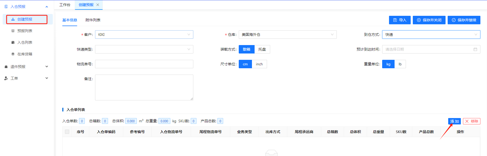

选择业务类型，点击添加货箱信息，或者点击导入下载模板导入箱单。

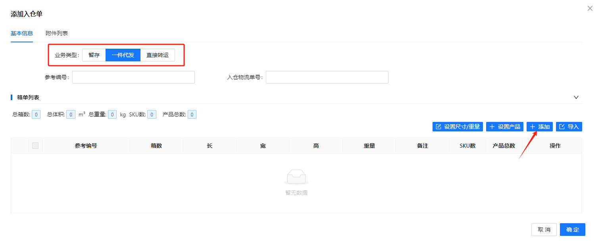

一件代发业务必须录入产品SKU以及产品数量以便仓库收到货物后做上架

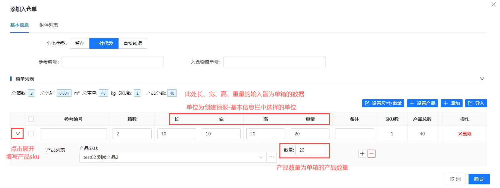

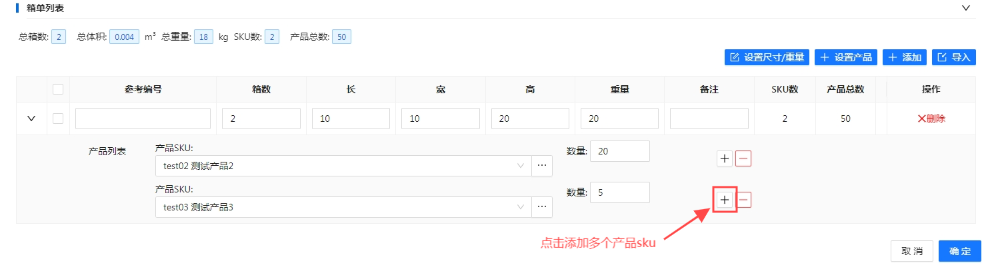

选中箱单，点击设置尺寸/重量，可一键设置箱子长宽高和重量。

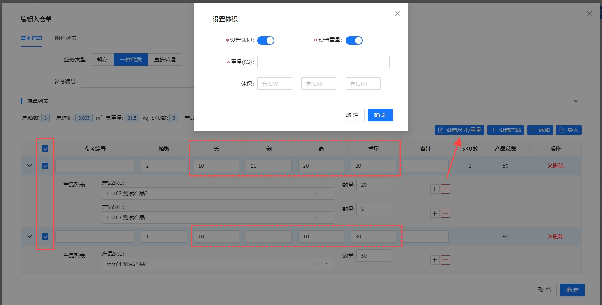

同一预报单允许创建多个不同的业务类型，通过在入仓列表添加不同货物的业务，设置完成后保存。

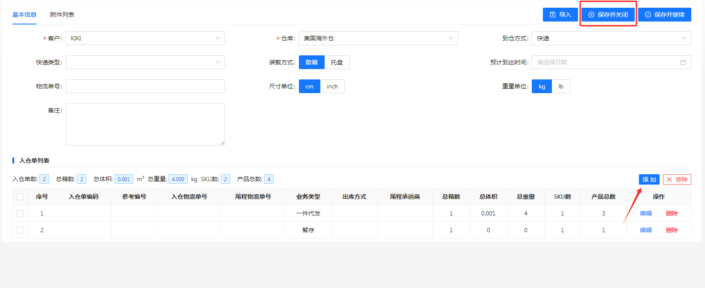

## 二、入仓接收

**【功能入口】（入仓—入仓预报—预报列表）**

---

创建完成的预报单会展示在预报列表的**待接收**界面，点击操作进行接收。

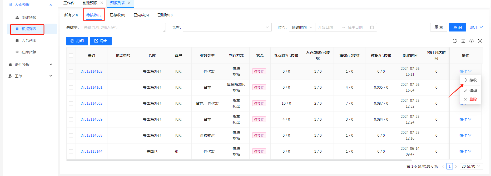

核对货物信息与预报信息一致后，可以点击全部接收后保存，或按照货物实际情况修改箱子的尺寸、重量

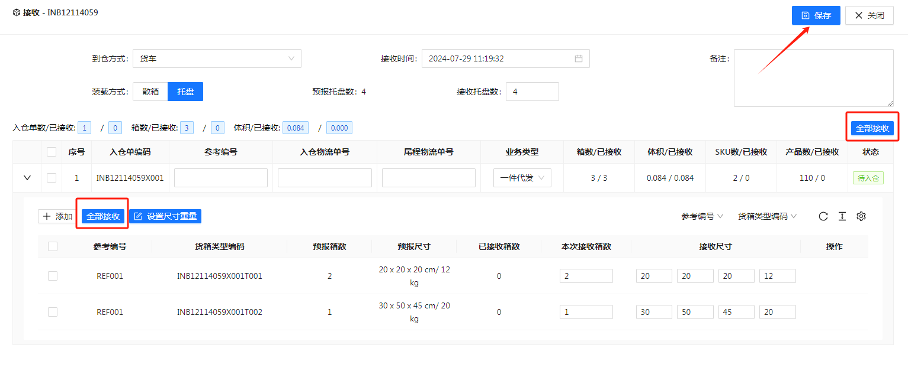

选中箱单可以批量设置体积重量

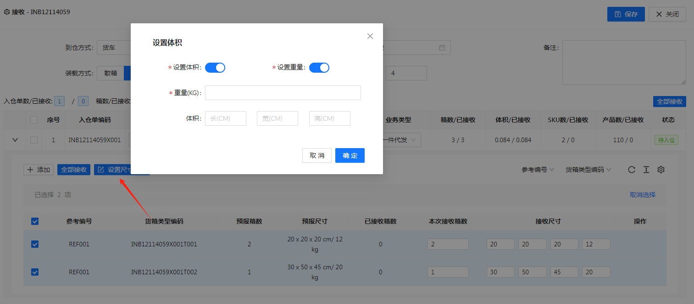

货物分批派送到仓，则填写实际接收数，保存后预报单进入**已接收**界面，后续货物到仓后可再次点击接收来录入货物数据。

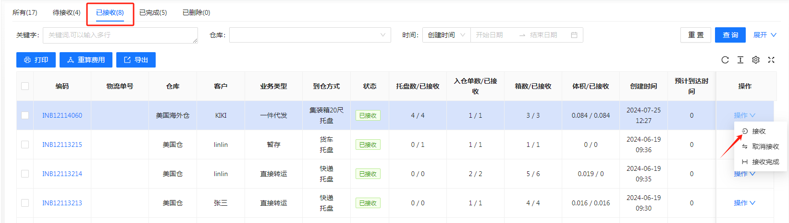

## 三、产品上架

**【功能入口】（入仓—入仓预报—入仓列表）**

---

货物接收入仓后，到入仓列表的**已入仓**界面操作上架

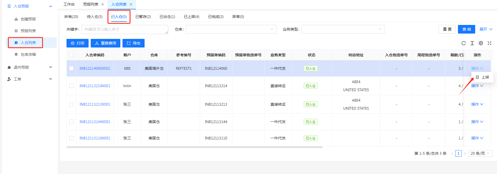

录入处理数量或点击**选择所有剩下货箱**一键录入，点击**下一步**

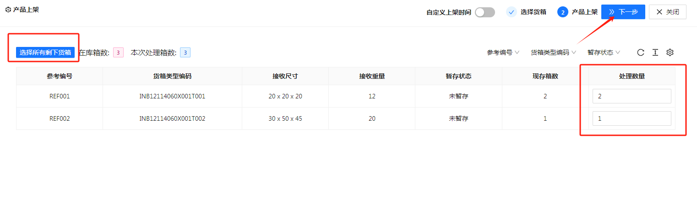

仓库已存在的SKU,系统会自动录入产品尺寸、重量，新品需手动录入收货时的实际尺寸、重量，以便仓库后期费用的核算。尺寸单位按仓库默认单位自动转换。

选择上架库位后保存，库位需先在仓库-库位管理中创建。如收到的产品有不良品，可点击添加录入次品数量

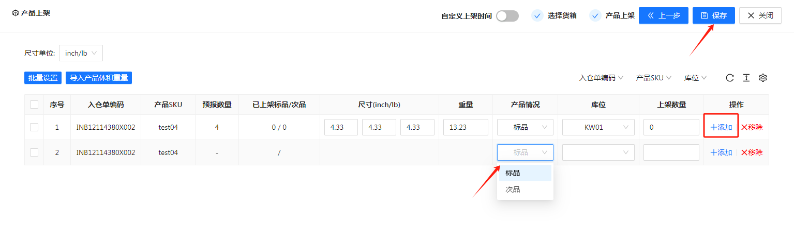

可选中入仓单后批量设置上架库位和上架数量

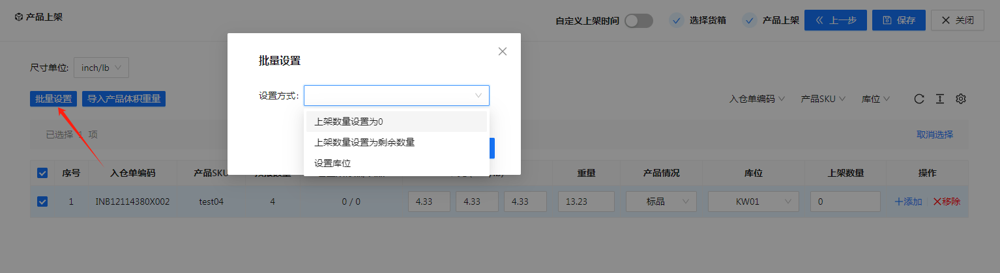

保存成功的入仓单会进去**已上架**界面，同时仓库会生成产品库存，分批到货的货物也可以在操作到仓后再次录入上架

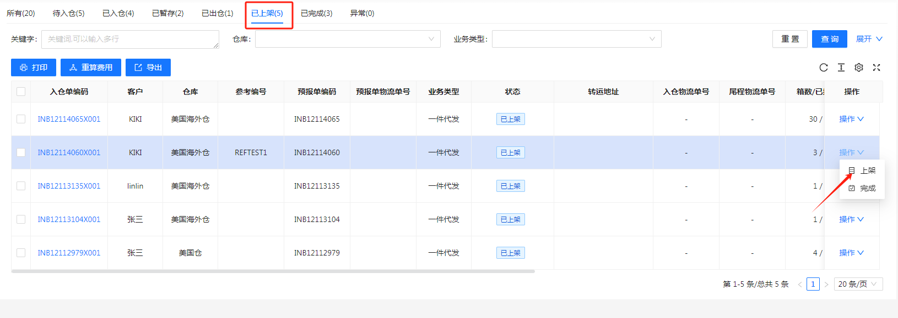

该入仓单产品全部上架完成后，点击完成并核对费用

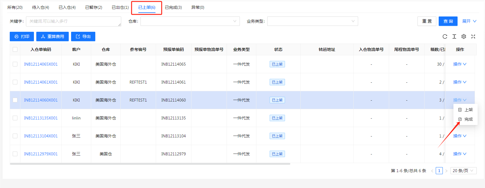

费用核对无误后确定保存该入仓单处理完成

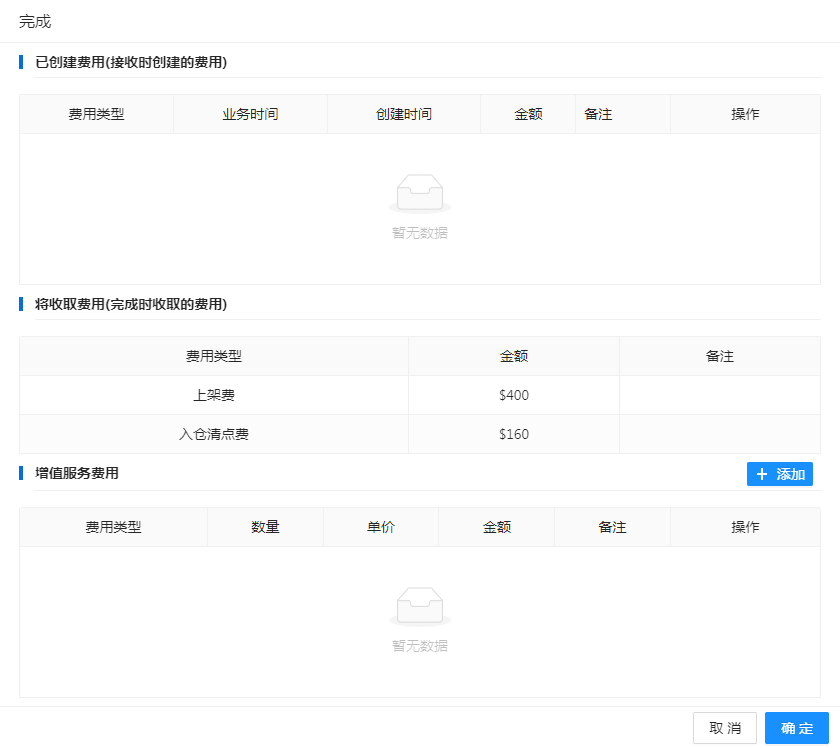

入仓单全部处理完成后，可在预报列表**已接收**界面完成该预报单并核对费用

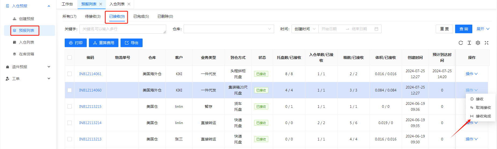

点击添加还可以为该预报单添加其它的增值费

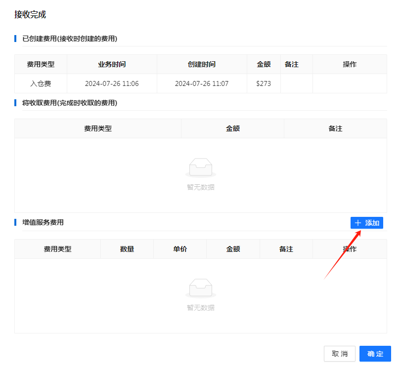

费用核对无误后点击确定保存，预报单转入**已完成**界面，至此该入仓预报单全部处理完成。

<!-- 源页面：https://help.dmxsmart.com/docs/wms/Management/WarehouseManagement/OnePieceDropshipping -->
