# 转运

## 一、创建入仓预报

**【功能入口】（入仓—入仓预报—创建预报）**

---

入仓预报由客户自行创建，仓库也可以帮助客户创建货物的预报。选择客户、仓库和到仓方式，选择货物的装载方式**散箱/托盘**，托盘需录入托盘数量，选择预计到达时间，物流单号或者柜号/车牌号。

入仓单列表栏点击**添加**，添加入仓单。

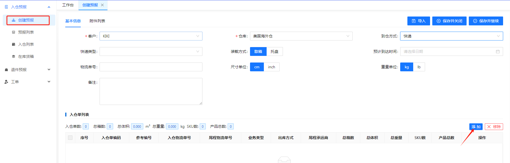

业务类型选择**直接转运**，选择出库方式，使用**第三方尾程**和**自提**的需录入承运商以便仓库进行货物的交接。

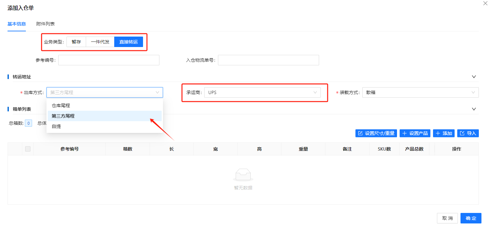

物流方式选择**使用仓库尾程**时，需要录入详细的目的地址，仓库在接收到货物后按提交的转运地址来进行尾程派送。

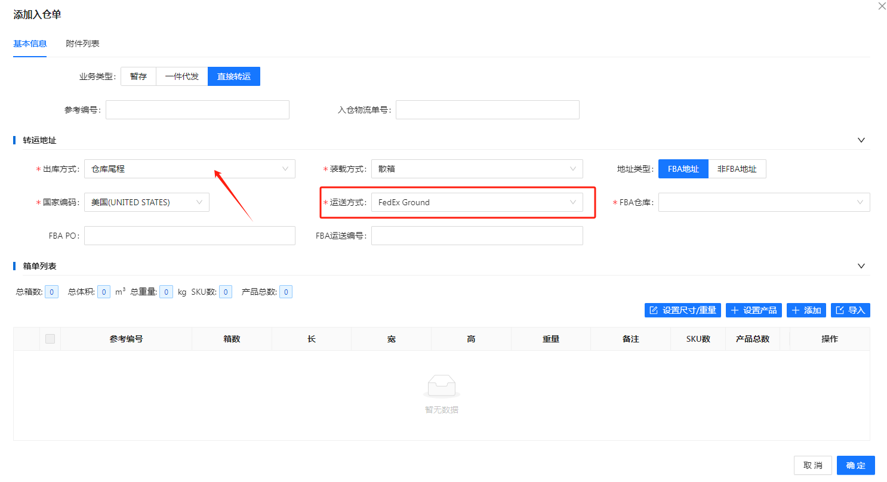

信息编辑完成后保存。

## 二、仓库接收转运

**【功能入口】（入仓—入仓预报—预报列表）**

---

在预报列表的**待接收**界面对该预报单进行接收。

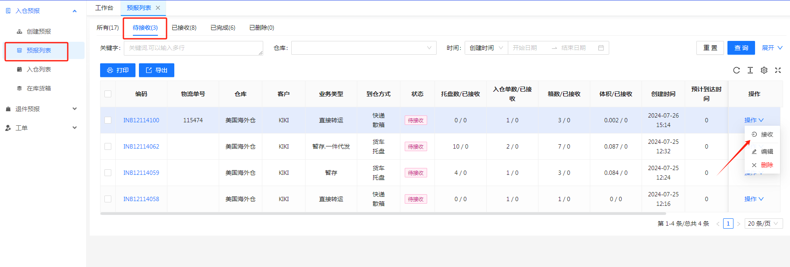

核对货物信息与预报信息一致后，可以点击全部接收后保存，或按照货物实际情况修改箱子的尺寸、重量

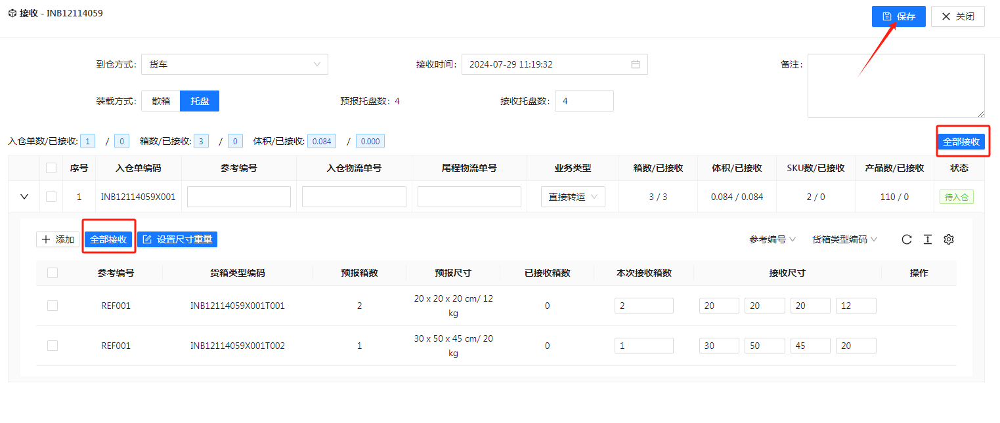

选中箱单可以批量设置体积重量

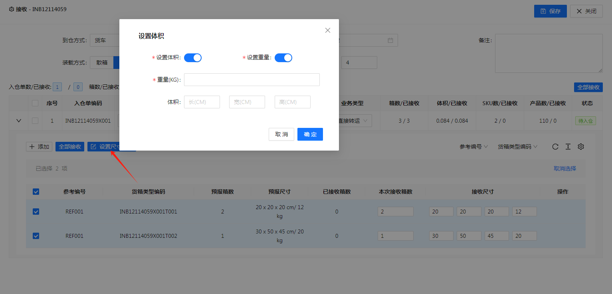

保存接收后预报单转入会**已接收**界面，对预报单进行完成操作并核对入仓费用

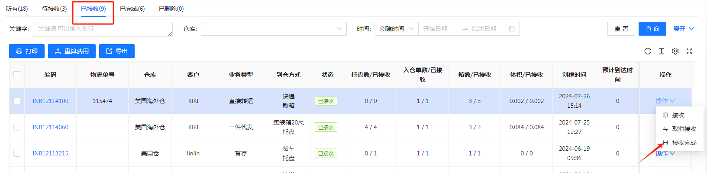

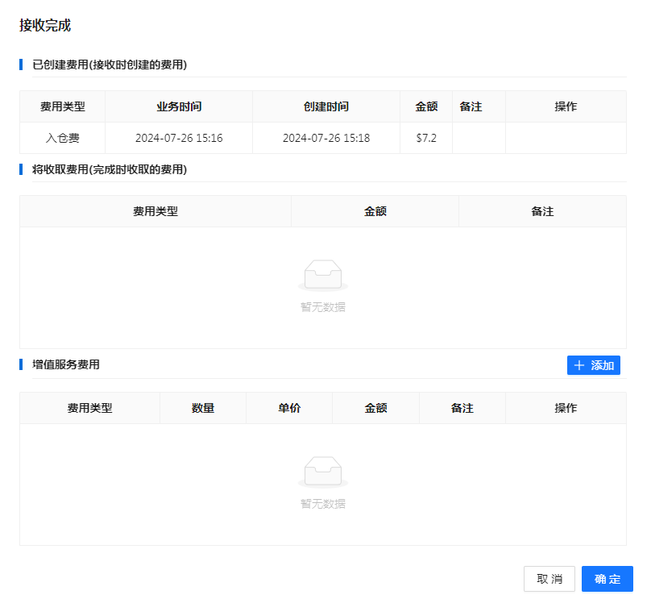

在入仓列表的**已入仓**界面对接收的货物进行转运操作，点击**出库**

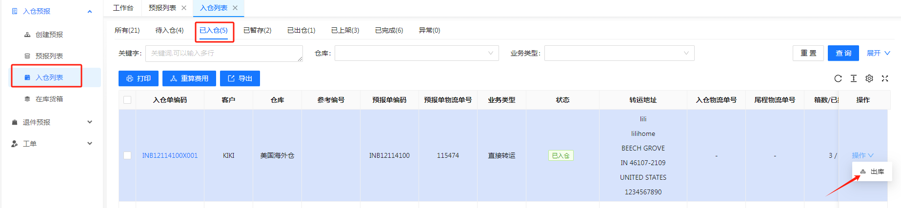

填写出库时间和转运数量，点击下一步

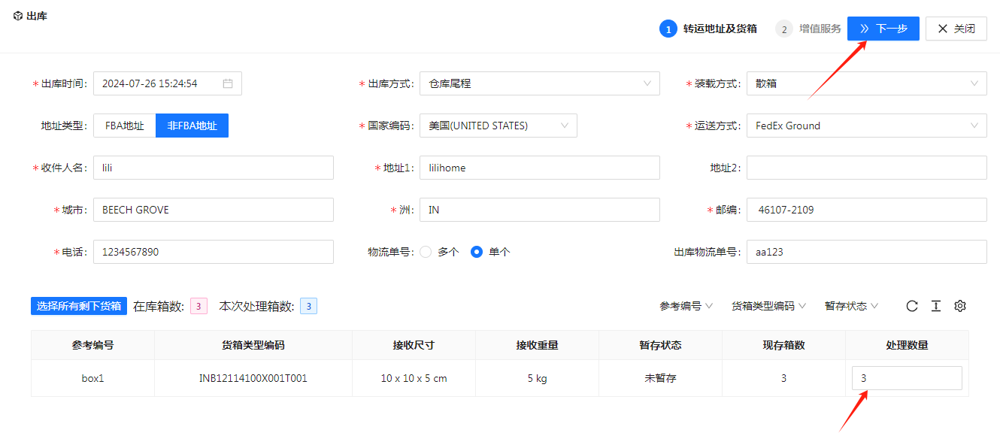

添加增值费用后保存， 货物转入**已出仓**界面

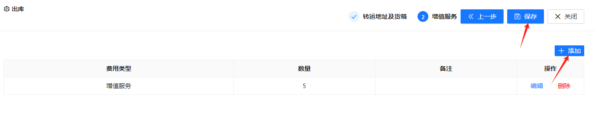

货物转运完成后，在已出仓列表对货物进行完成操作并核对产生的费用

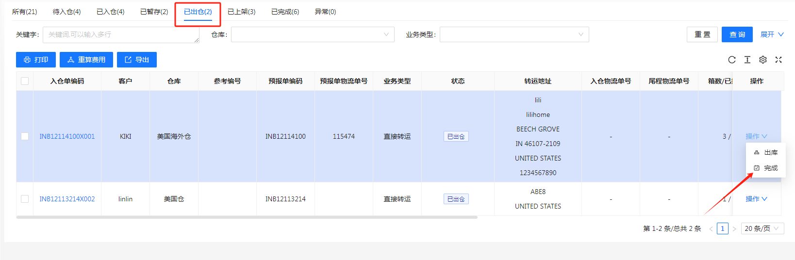

费用核对无误后确定保存，该业务处理完成

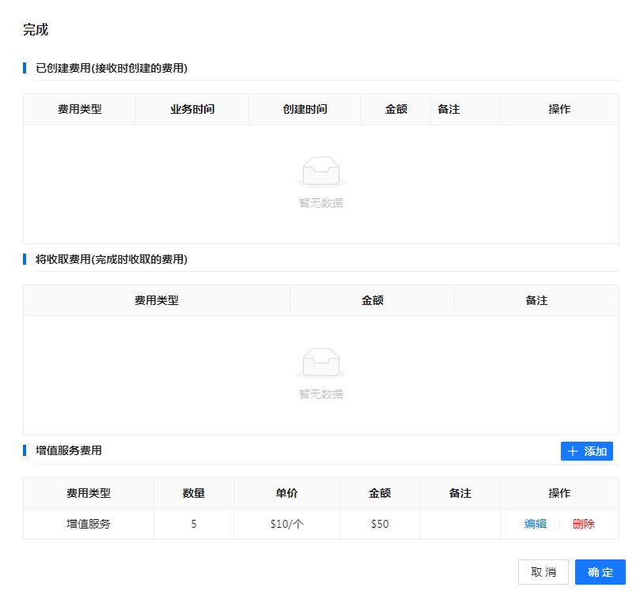

<!-- 源页面：https://help.dmxsmart.com/docs/wms/Management/WarehouseManagement/transport -->
