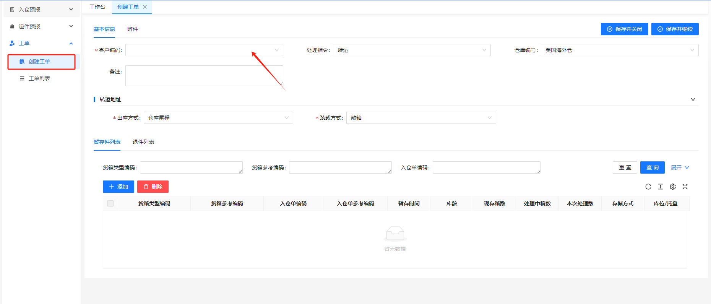
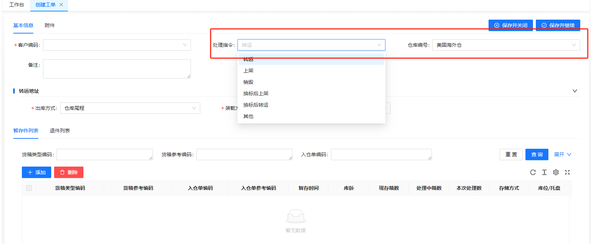
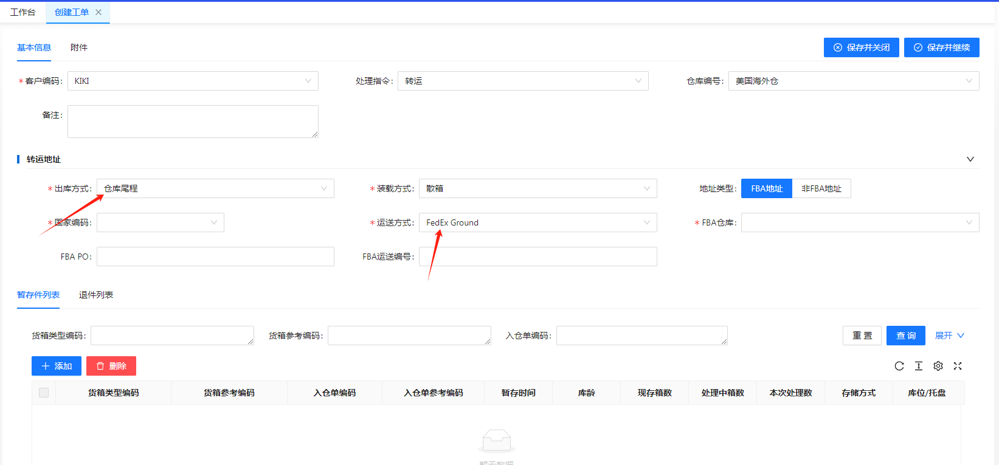
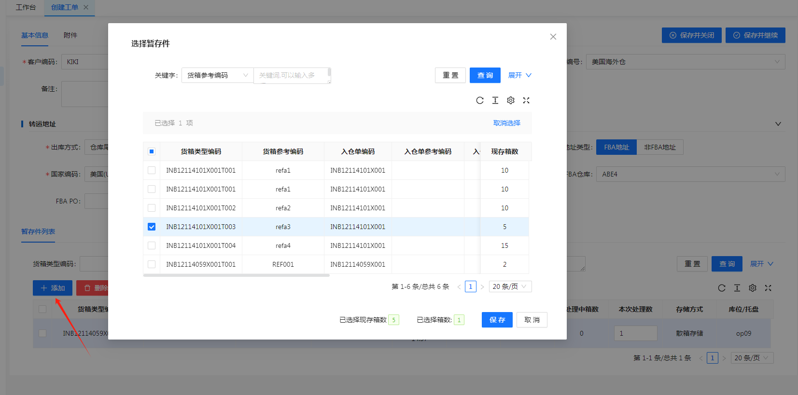
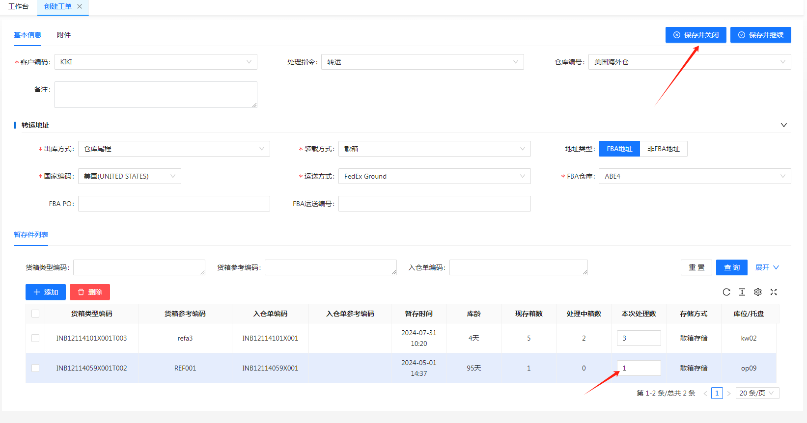
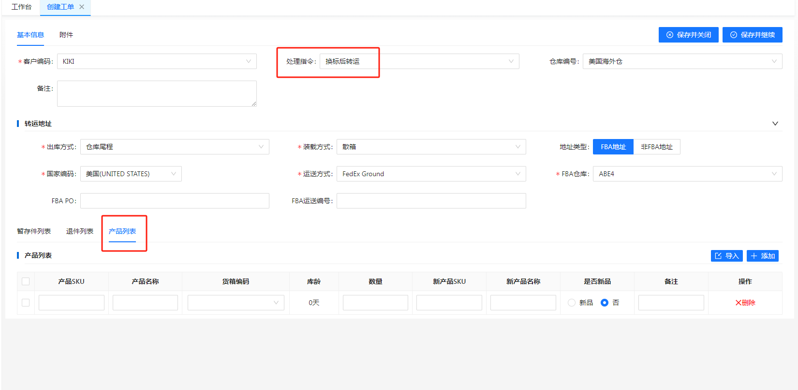
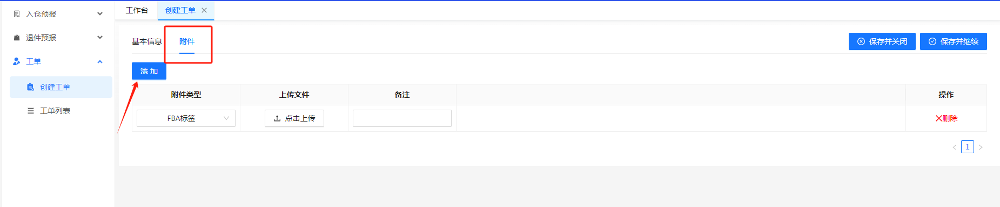
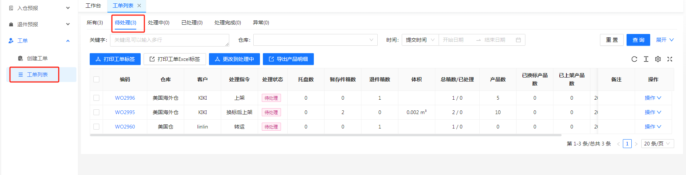
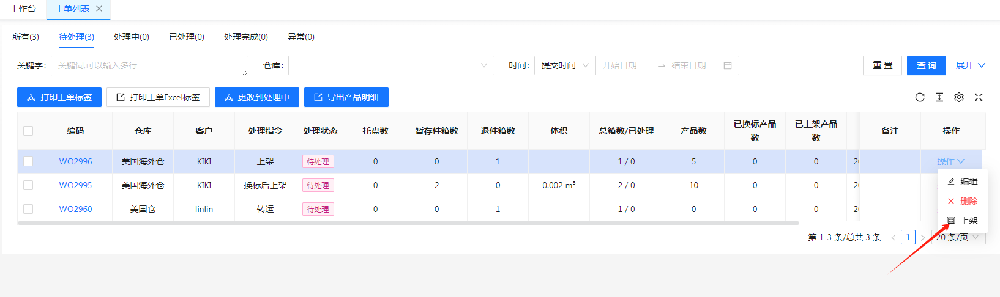

# 工单

【**功能概述**】在库的暂存货物，客户通过提交不同的操作指令给仓库后，仓库对暂存件进行不同的处理动作。

【**功能入口**】（**入仓---工单**）

## 一、创建工单

客户和仓库都可以创建工单，仓库创建时需选择退货所属客户

选择货物所在的仓库以及对货物的处理动作  

当选择**转运**或**换标转运**时，需要录入转运地址并选择货物的**运送方式**  

暂存件/退件列表处点击**添加**，选择需要转运的货箱  

录入需要处理的箱数后保存，工单提交完成  

**换标转运**和**换标上架**的处理动作需要在产品列表录入换标的产品信息  

在**附件**上传产品SKU标签  

## 二、工单处理

客户提交的工单展示在工单列表中

仓库根据客户提交的工单需求,对客户暂存的货物进行转运、换标、出库等操作  

<!-- 源页面：https://help.dmxsmart.com/docs/wms/Management/WorkOrder -->
