# 订单出库

## 拣货任务

客户提交出库的订单由wms系统管理端创建拣货波次并分配给仓库人员拣货

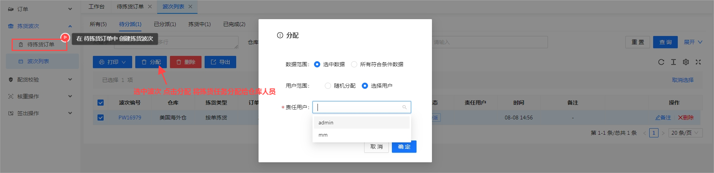

仓库人员在 **出仓-拣货任务** 查看拣货任务，对分配给自己的任务进行拣货

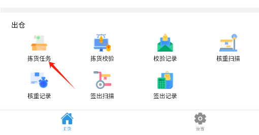

点击搜索波次，可点击查看此波次订单详情和产品详情，点击拣货开始拣货任务。

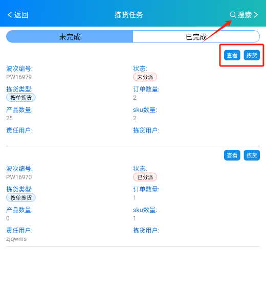

按照提示库位、产品SKU和数量进行拣货，完成后点击保存并进入下一订单

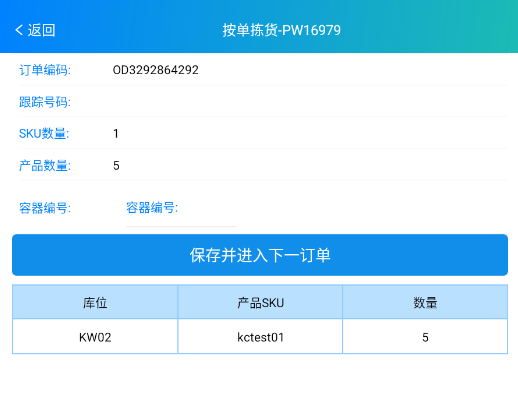

可在已完成中查看已完成的拣货波次

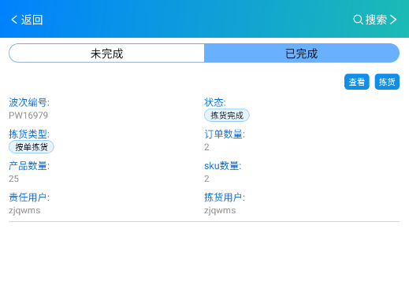

## 拣货校验

拣货完成后使用 **出仓-拣货校验** 对按单拣货的订单SKU和数量进行校验，用于验证拣货的正确性以及对集中拣货的订单进行二次分配。

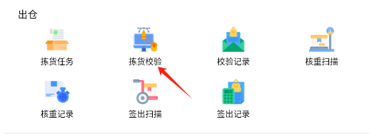

扫描订单条码或者包裹跟踪号码

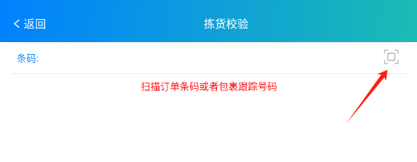

扫描产品sku条码

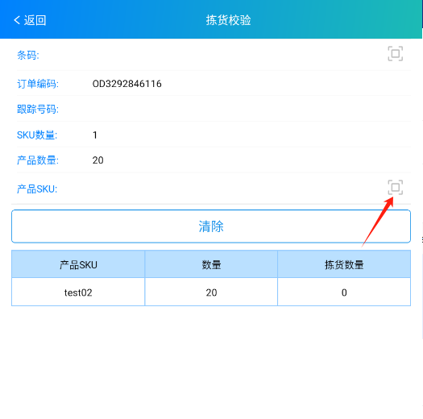

输入拣货数量，点击设置拣货数量，拣货数量与订单数量一致时，订单完成校验。

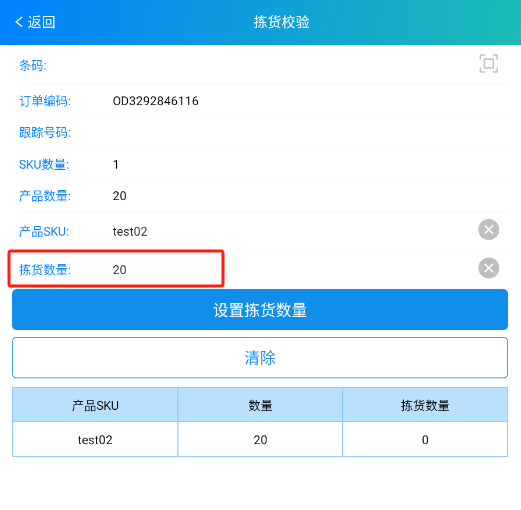

## 核重扫描

完成校验的订单仓库人员使用 **出仓-核重扫描** 对货物进行签出前的打包核重，以确定订单费用

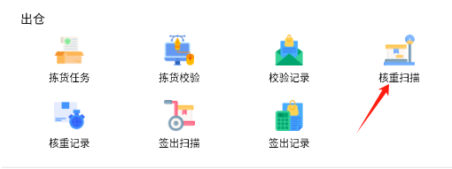

扫描订单条码或包裹跟踪号码，点击设置选择订单核重时需要录入的信息

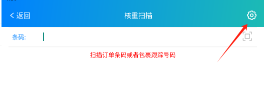

需使用仓库包材的订单打开录入材料后选取包材。对于需要更换发货渠道的订单，打开录入运送渠道改变运送方式

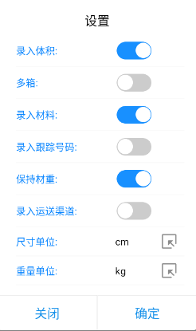

在对包裹称重后扫描订单编号或者跟踪号码录入重量后点击保存

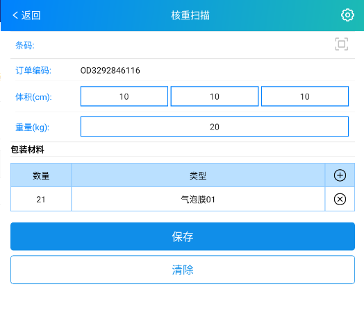

## 签出扫描

仓库人员 **出仓-签出扫描** 使用扫描跟踪号码或者订单编号，对包裹进行签出操作。

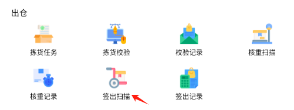

扫描订单条码或者包裹跟踪号码

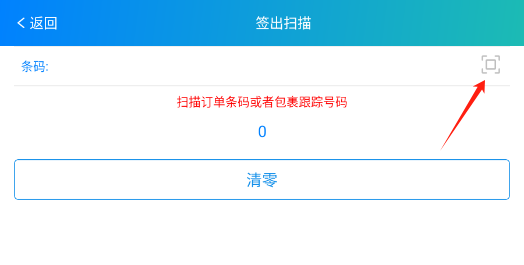

可连续扫描包裹签出订单

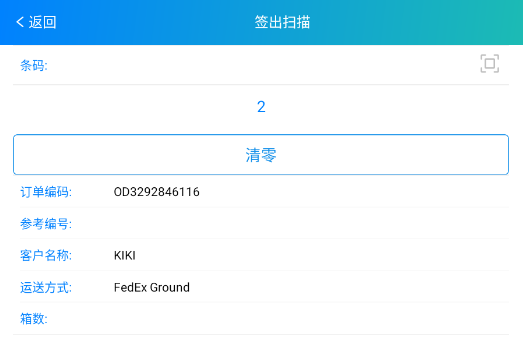

## 校验记录

完成校验的订单可在 **出仓-校验记录** 中查看

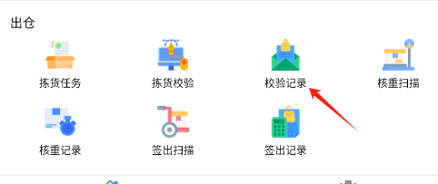

点击搜索查找校验记录，校验后未核重出库的订单可取消校验

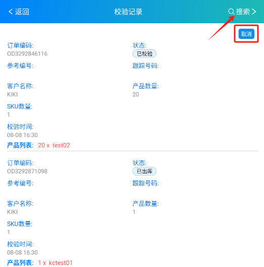

## 核重记录

完成核重的订单可在 **出仓-核重记录** 中查看

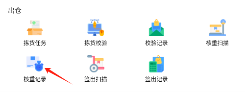

点击搜索查找核重记录，核重后未出库的订单可取消核重

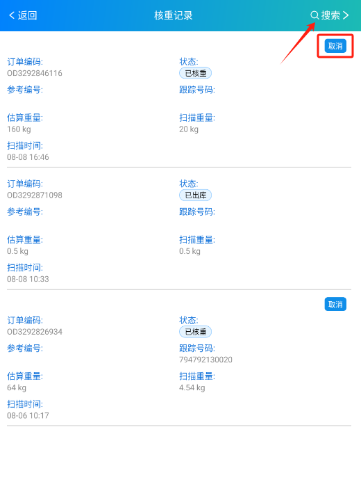

## 签出记录

完成签出的订单可在 **出仓-签出记录** 中查看

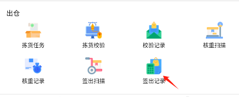

点击搜索查找签出记录，可对出库的订单取消出库

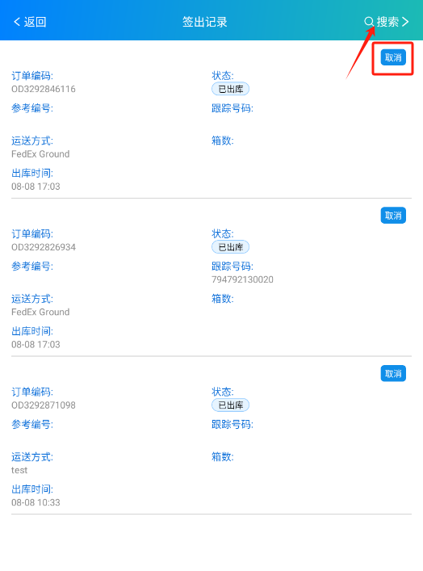

<!-- 源页面：https://help.dmxsmart.com/docs/wms/PDAOperation/OrderOutbound -->
