# 接收上架

## 接收

客户货物发往海外仓前需做入仓预报，并打印箱唛标签贴在外箱上。货箱到库后仓库人员需要手持PDA设备进行仓库预报接收。  
入仓预报会在预报列表-待接收中显示。

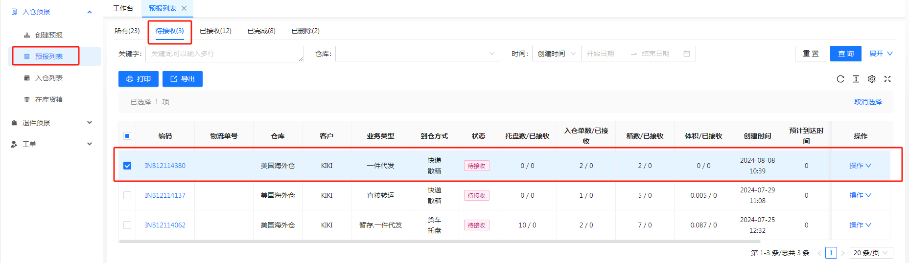

### 按箱接收

仓库人员使用 **入仓-按箱接收** 扫描货箱的入仓箱唛条形码进行接收操作

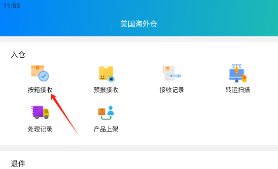

点击扫描标签或输入货箱编码

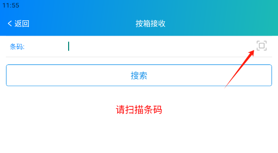

  
输入接收货箱尺寸，点击保存接收，该预报单将转入已接收状态  

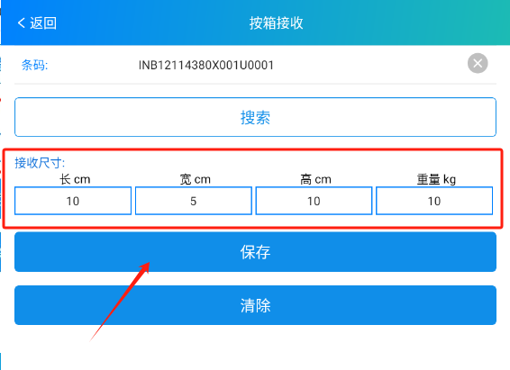

### 预报接收

使用 **入仓-预报接收** 扫描预报单编码或入仓单编码进行接收操作

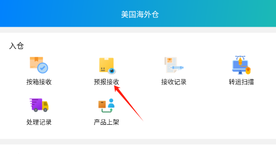

  
扫描后可以修改货箱的入仓时间（默认当前时间）、到仓方式、货箱装载方式和备注等，如不需要修改信息则直接点击下一步  

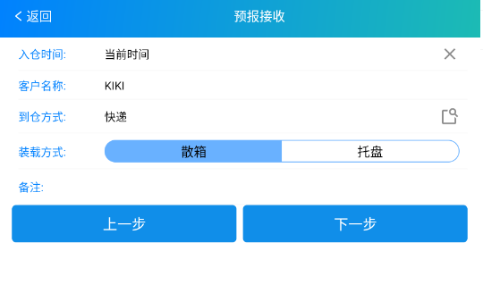

  
核对货物信息与预报信息一致后，可以点击全部接收，或按照货物实际情况修改箱子的尺寸、重量。

填写好本次接收的货箱长宽高以及接收箱数后点击**下一步**

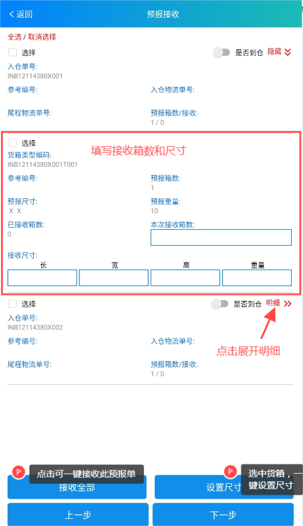

  
接收时可以选择上传接收的货箱清单等数据，最后点击保存即完成该批次的接收操作。  
该预报单转入已接收状态。  

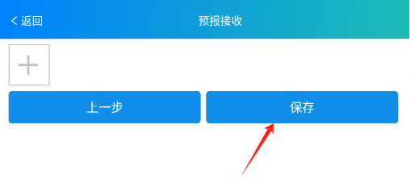

### 接收记录

仓库人员可在 **入仓-接收记录** 中查看接收货箱详情或取消某批次的接收操作

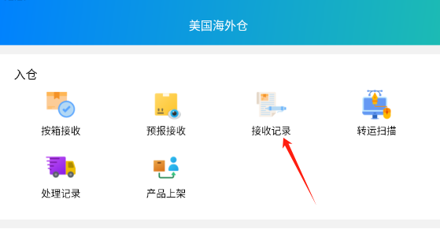

  
点击搜索查找接收记录，取消某批次的接收或查看入仓预报详情  

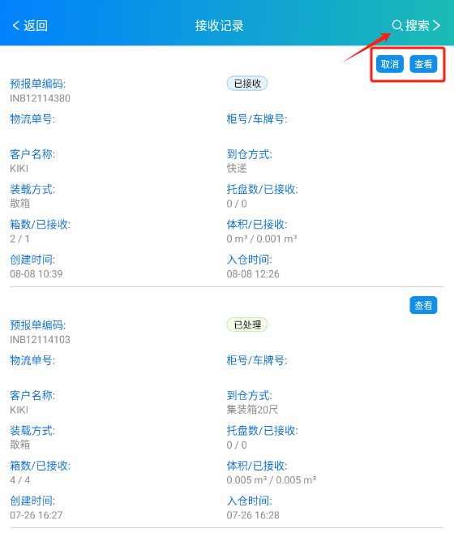

## 上架

### 产品上架

接收完成后，使用 **入仓-产品上架** 扫描本次要处理上架的货箱箱唛，进行产品上架

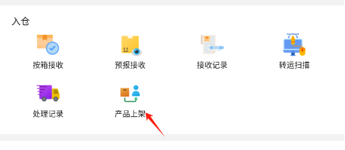

  
填写处理数量或选择所有货箱，点击下一步  

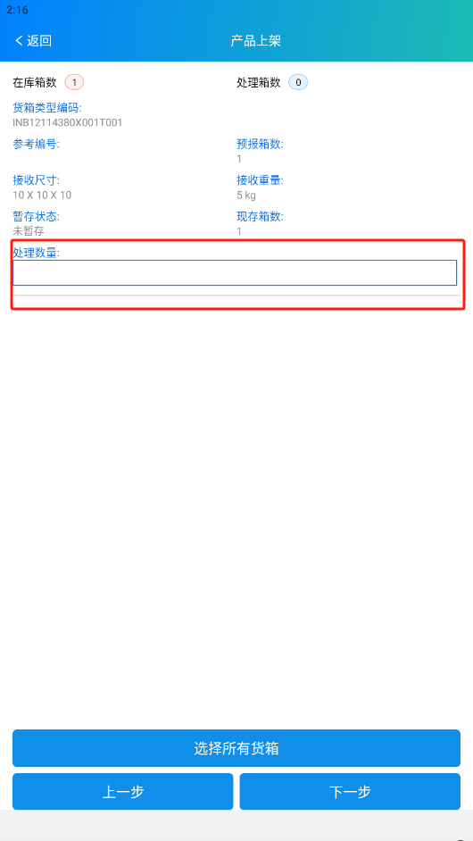

扫描产品sku标签以及库位标签，填写本次的上架的产品数，如果该sku之前有在仓库有上架过则将自动填充长宽高重量等数据。

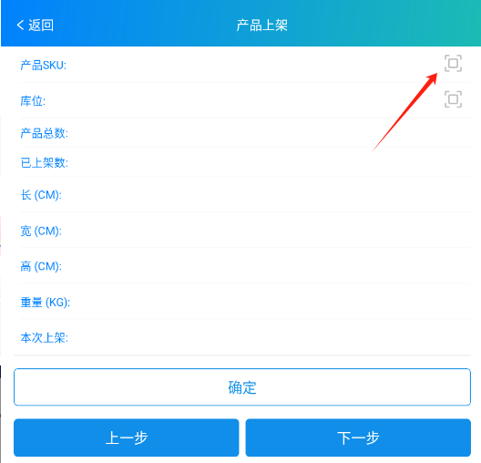

  
点击确定 确认上架这一款sku，填写完成后点击下一步  

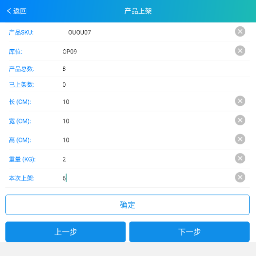

  
查看本次操作上架清单和汇总，确认无误后点击保存完成本轮上架操作  

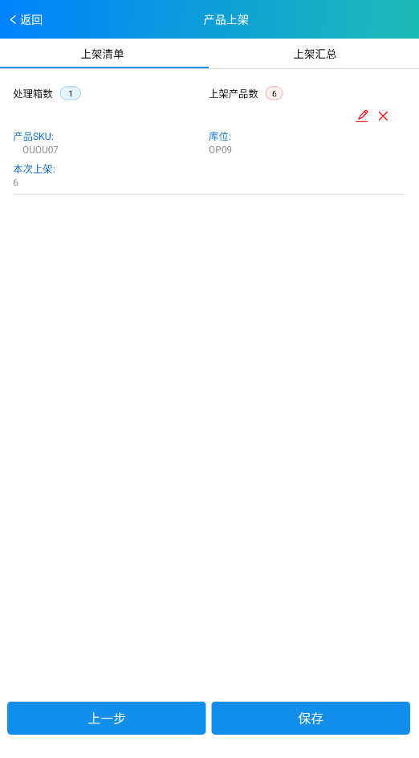

### 处理记录

可在 **入仓-处理记录** 中查看货物上架、暂存和转运处理记录

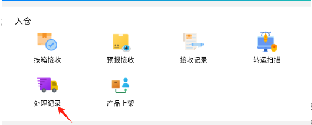

  
点击搜索查找处理记录，对于未完成的上架操作可点击取消该次上架  

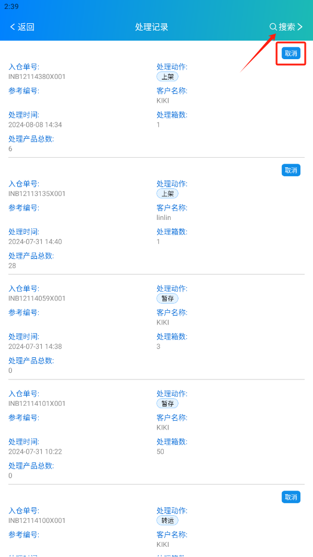

<!-- 源页面：https://help.dmxsmart.com/docs/wms/PDAOperation/ReceiveAndPutOnShelves -->
