# 工单

## 工单列表

### 暂存件上架

仓库人员使用 **工单-工单列表** 查看客户提交的工单并对暂存件进行相应操作

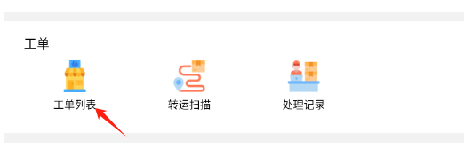

  
点击搜索工单编码，可点击查看工单详情并对工单进行操作  

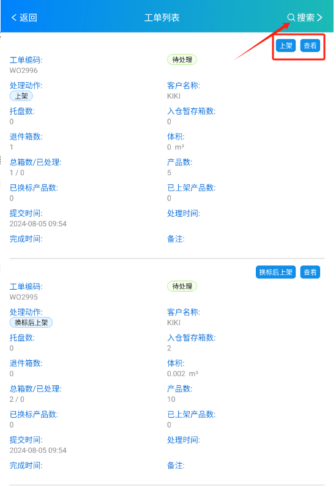

  
填写本次处理货箱或点击处理所有货箱，点击下一步进行上架操作  

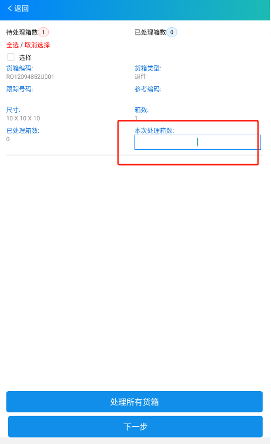

  
填写产品上架信息，点击保存完成该SKU信息填写，全部填写完毕后点击下一步  

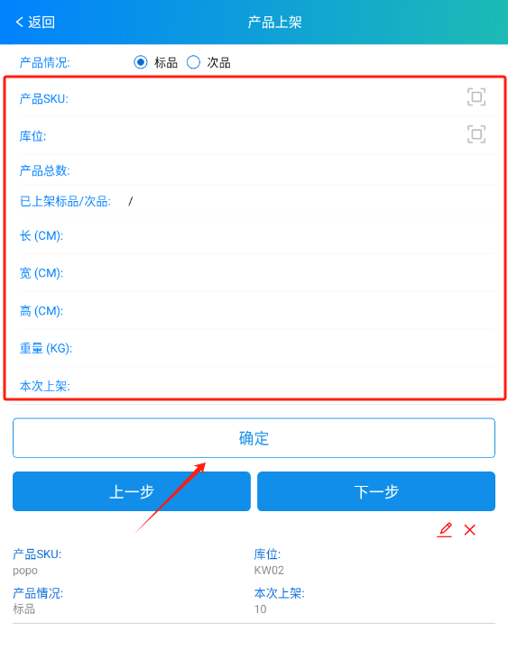

  
查看本次操作上架清单和汇总，确认无误后点击保存完成本轮上架操作  

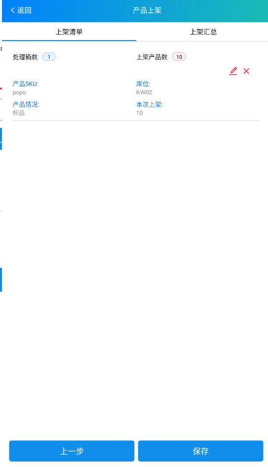

### 暂存件转运

点击转运对暂存件进行操作

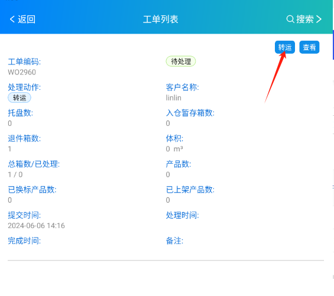

  
填写本次处理货箱或点击处理所有货箱，点击下一步进行转运操作  

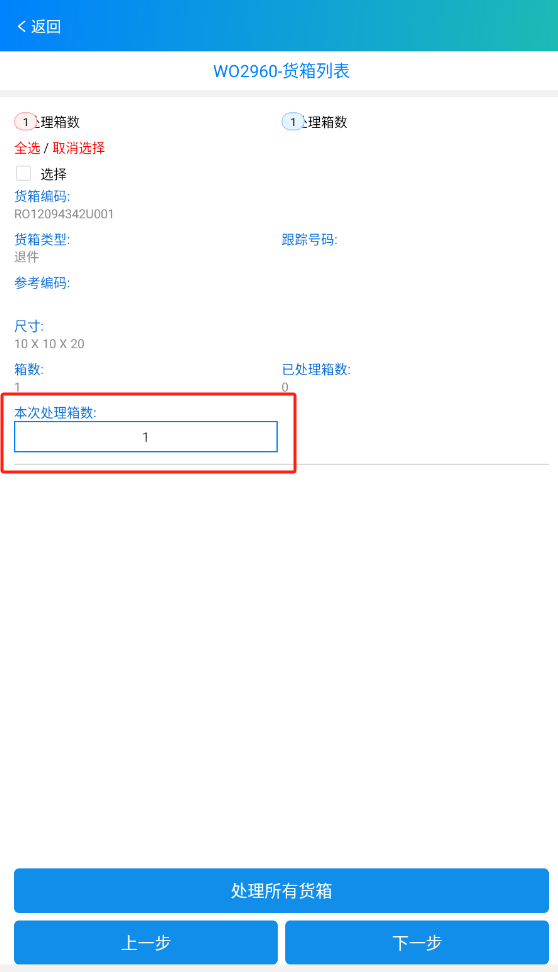

  
选择出库时间、出库方式和装载方式，使用仓库尾程需填写转运地址，填写完成后点击下一步。  

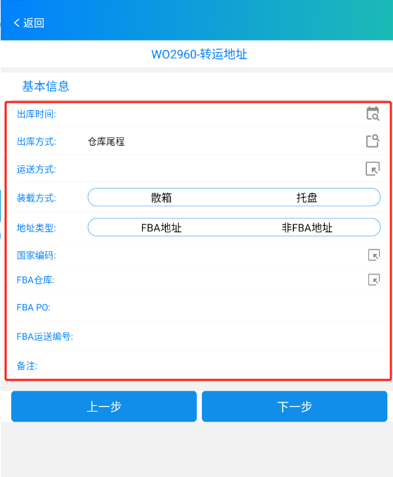

扫描物流单号，可点击添加多个货箱，填写货物信息后点击下一步

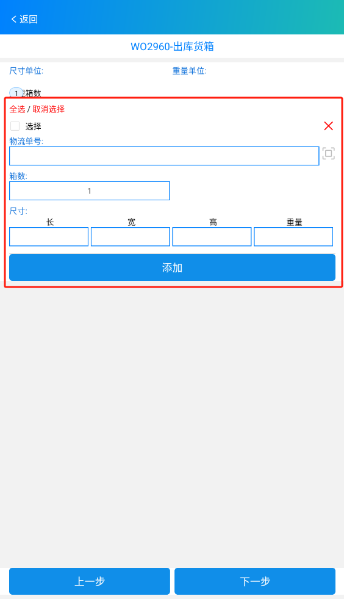

  
点击添加增值服务费，点击保存完成此次暂存件转运操作  

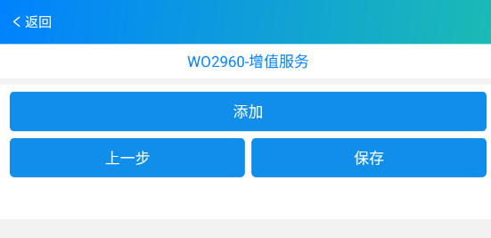

## 转运扫描

暂存件转运也可使用 **工单-转运扫描** 来进行操作转运，转运步骤与在 工单-工单列表 中转运一致

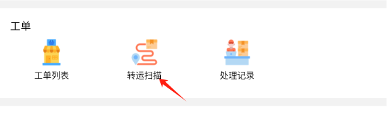

## 处理记录

可在 **工单-处理记录** 中查看工单的处理记录

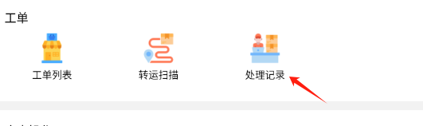

  
点击搜索查找处理记录，可点击取消此次对暂存件的操作  

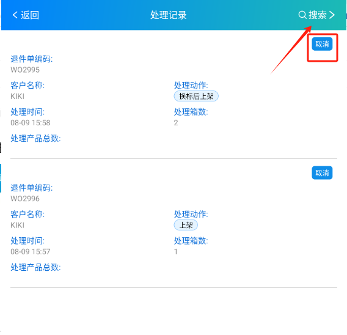

<!-- 源页面：https://help.dmxsmart.com/docs/wms/PDAOperation/WorkOrder -->
