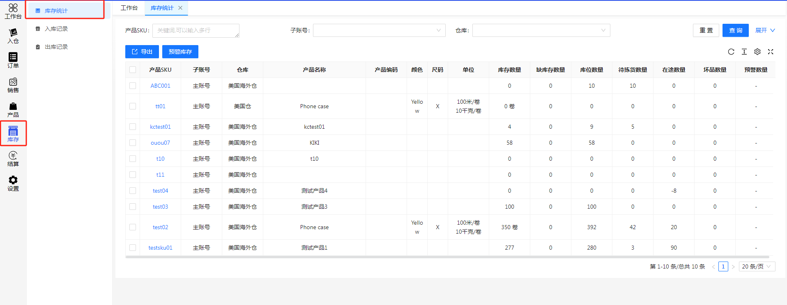
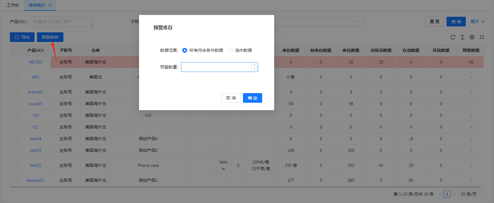
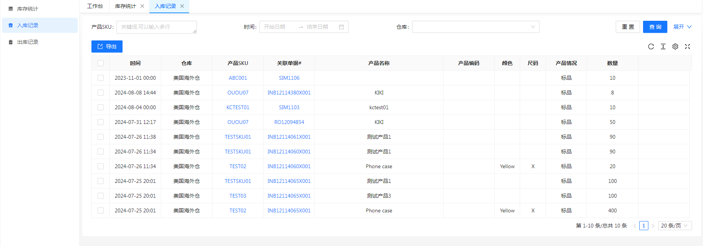
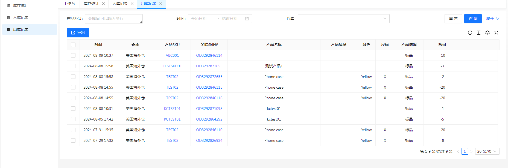

# 库存管理

【**功能概述**】对库存信息进行查看、导出。

### 库存统计

可点击预警库存输入预警数量，当库存数量低于预警数量时，库存将标红预警。

### 入库记录

### 出库记录

<!-- 源页面：https://help.dmxsmart.com/docs/wms/UserSideFunctionDescription/DocumentTutorial/InventoryManagement -->
