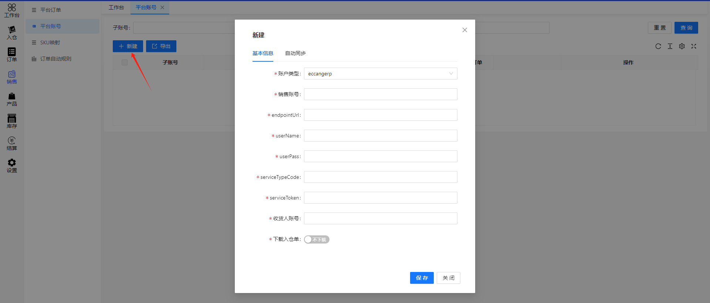
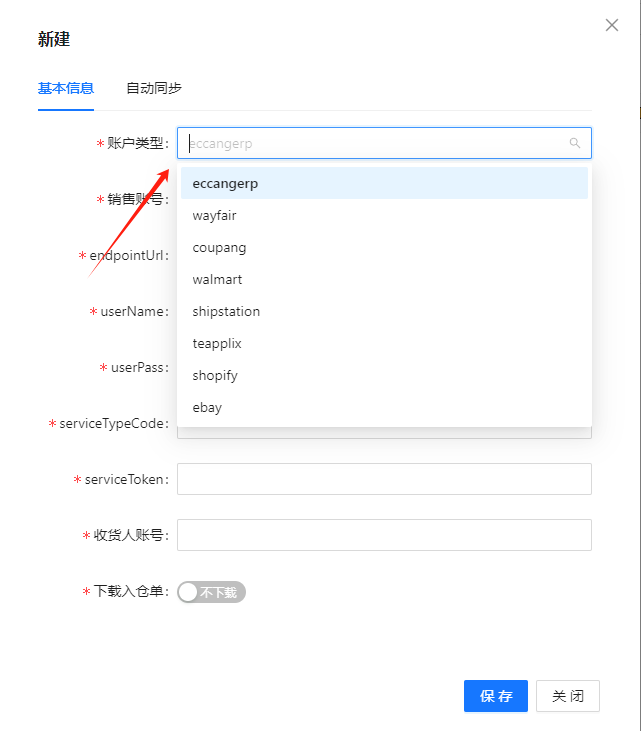
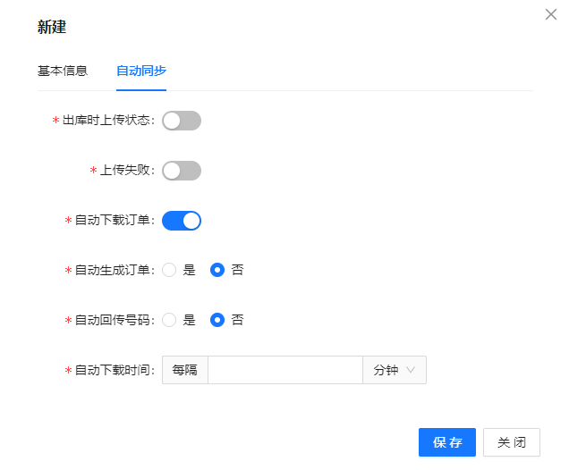

# 平台账号

【**功能概述**】销售平台账号授权以及订单自动同步规则设置

点击**新建**，选择销售平台的账户类型

不同的账户类型所需的对接材料不同，请录入销售平台提供的对接信息进行对接...

**自动同步**设置订单同步规则

**出库时上传状态**---仓库操作订单出库后，将发货状态返回至平台（只针对有开放发货状态回传的平台）

**上传失败**---出库状态上传失败提醒

**自动下载订单**---根据设置的自动下载时间，系统到平台自动获取待发货订单提交到系统

自动同步的订单还需要创建**订单自动规则**来匹配发货仓库以及发货渠道，系统根据规则操作订单自动提交出库。

<!-- 源页面：https://help.dmxsmart.com/docs/wms/UserSideFunctionDescription/DocumentTutorial/SalesPlatform/PlatformAccount -->
