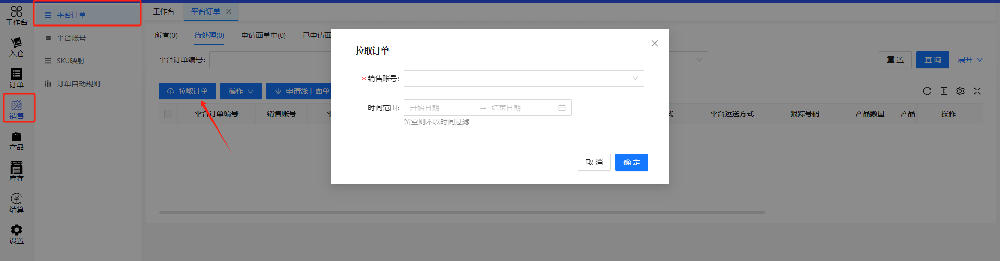
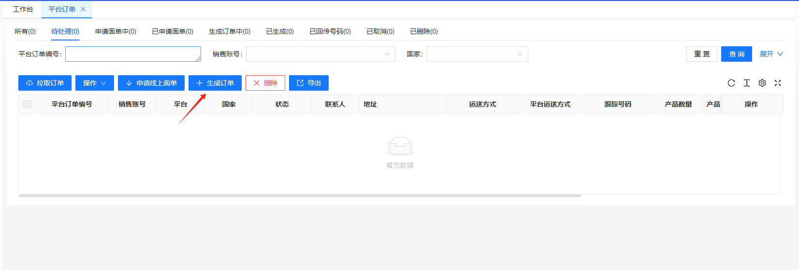
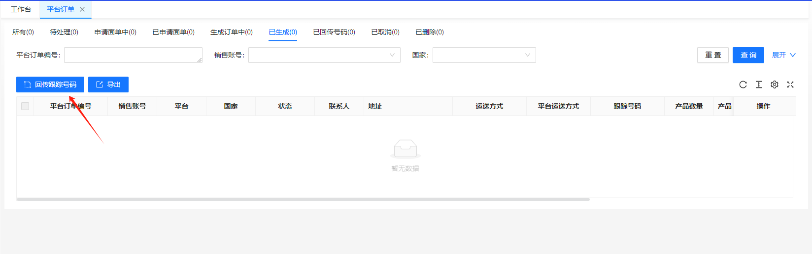
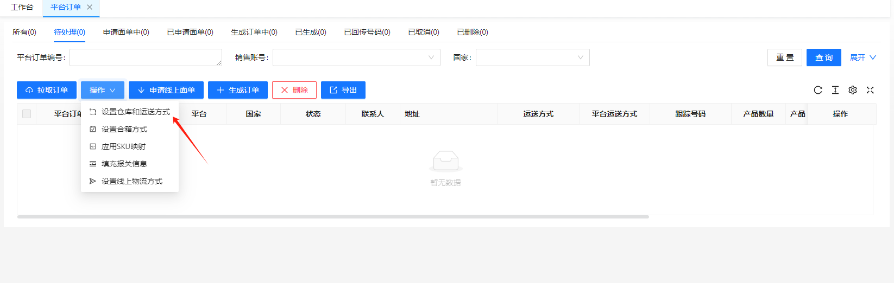
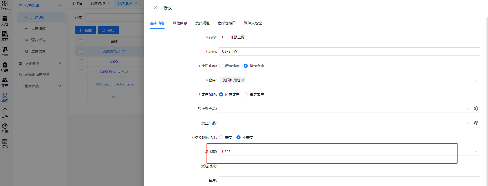

# 平台订单

## 平台订单

【**功能概述**】系统绑定销售平台账号后，可以通过手动拉取订单的方式将销售平台订单同步到系统中来。

点击**拉取订单**，选择销售平台账号和时间范围，系统会自动将销售平台订单拉取到系统中

订单拉取成功后，选择订单，点击**生成订单**来获取订单跟踪号码

生成跟踪号的订单会转入**已生成订单**栏，选中订单点击**回传跟踪号码**，订单跟踪号会同步至销售平台中

在待生成订单列表中，我们还可以通过**操作**来选择订单的发货仓库和运送方式

**SKU映射**和**报关信息填充**也可以通过**操作**来设置订单SKU在系统中的产品报关信息以及SKU映射应用。

## 平台订单常见问题

### 生成订单时提示配货信息不能为空

在销售平台没有维护货号，需先在平台上维护货号，在系统中删除订单并在已删除中清除订单后重新拉取订单。

### 回传单号时提示Required param serviceCode or trackingNo missing

需管理端在运送渠道中设置承运商

<!-- 源页面：https://help.dmxsmart.com/docs/wms/UserSideFunctionDescription/DocumentTutorial/SalesPlatform/PlatformOrders -->
