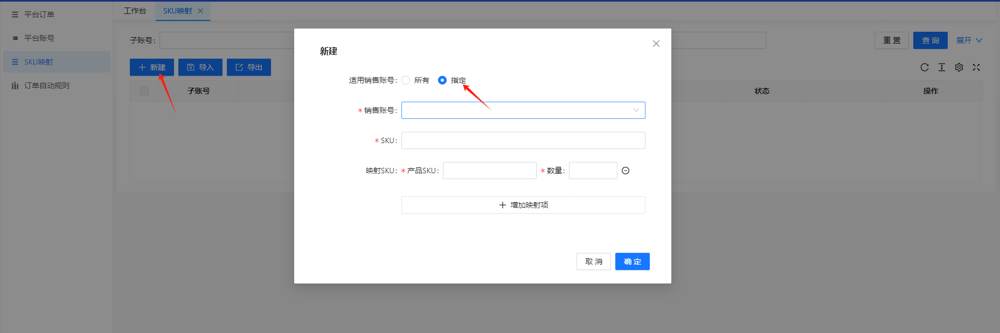
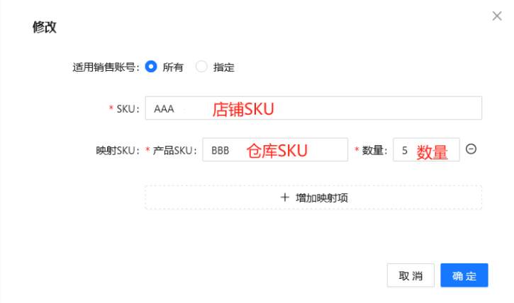
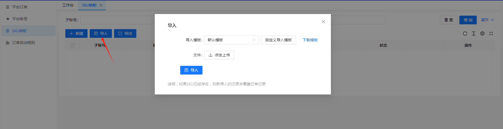

# SKU映射

【**功能概述**】当同一产品在不同销售平台Listing的SKU不同，或者Listing SKU与仓库SKU不同时，可以通过SKU映射来进行产品SKU的匹配.

点击**新建**，选择销售平台账号

录入销售平台Listing的SKU和映射到仓库的SKU确定保存，点击增加映射项可对组合产品实现多映射

SKU映射创建后，销售平台同步到系统的订单SKU会自动和仓库SKU进行匹配

也可以通过批量导入的方式来进行SKU映射的创建

<!-- 源页面：https://help.dmxsmart.com/docs/wms/UserSideFunctionDescription/DocumentTutorial/SalesPlatform/SKUMapping -->
