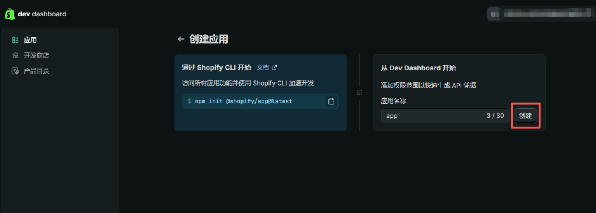
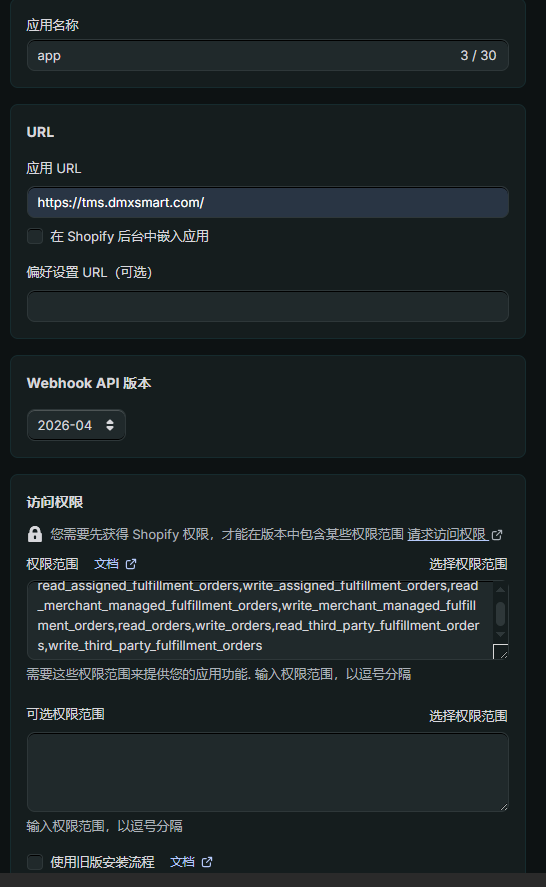
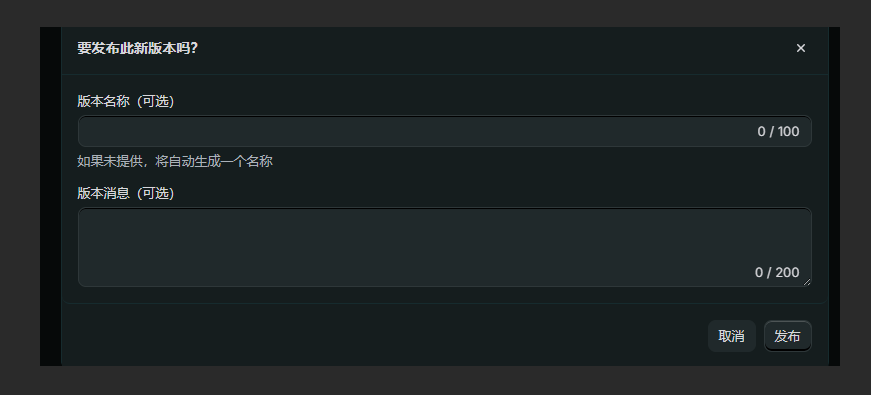
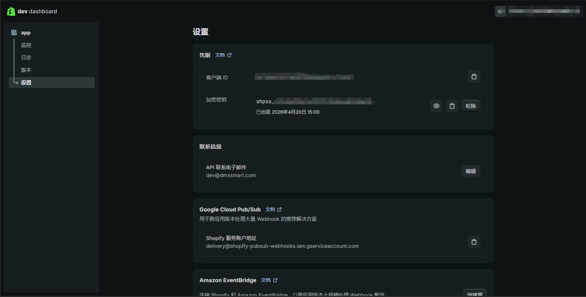
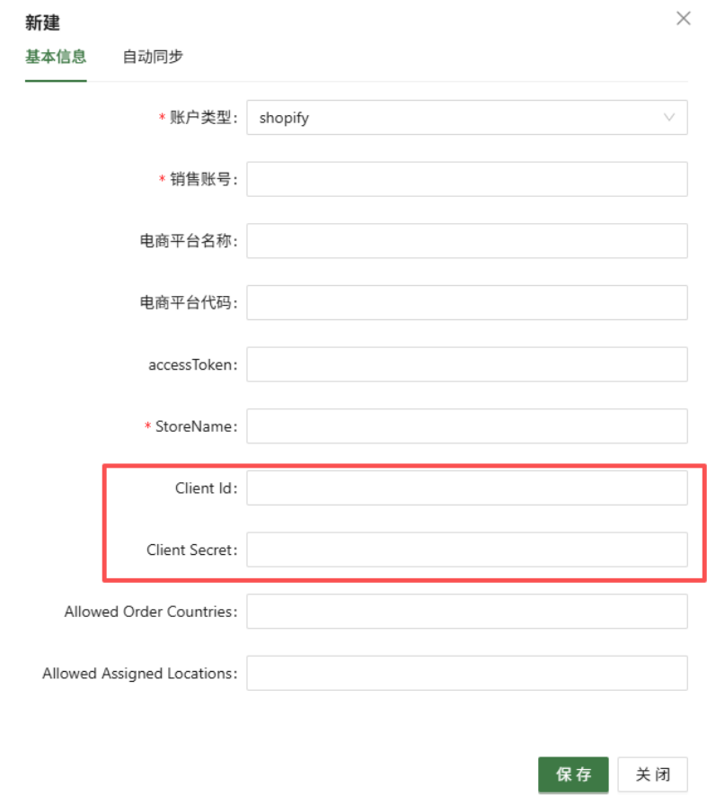
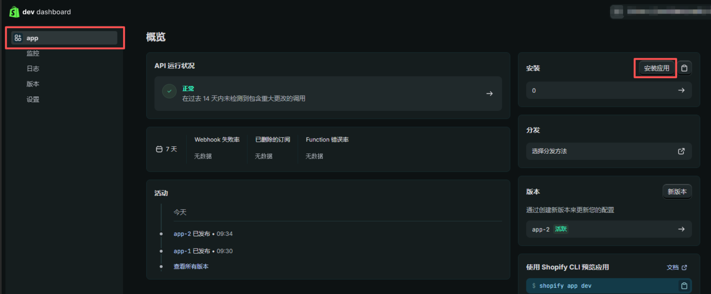
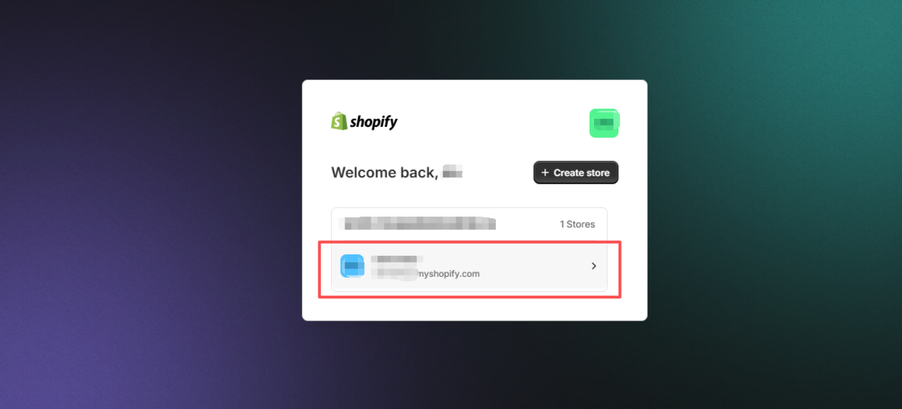
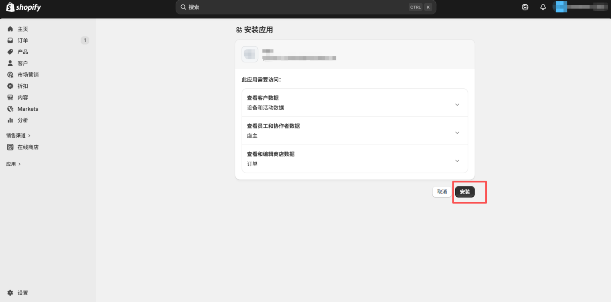
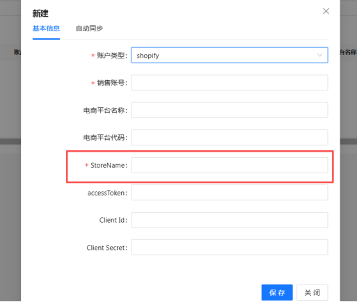
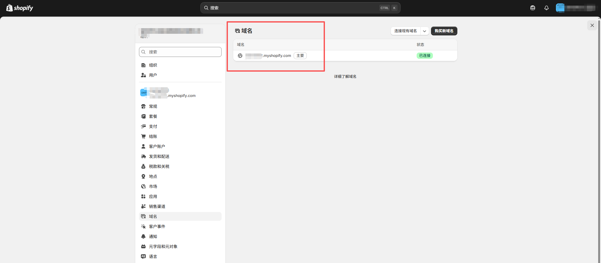

# Shopify

1. 应用名称随意填写，填写后点击【创建】.

2. URL-应用url填写<https://tms.dmxsmart.com/>
3. 访问权限-访问范围填写 read_assigned_fulfillment_orders,write_assigned_fulfillment_orders,read_merchant_managed_fulfillment_orders,write_merchant_managed_fulfillment_orders,read_orders,write_orders,read_third_party_fulfillment_orders,write_third_party_fulfillment_orders,read_customers

4. 填写完成后，在最下方点击【发布】
5. 版本名称无需填写，直接点击发布【发布】

6. 发布后，在左侧点击设置，客户端id和加密密钥填入系统。分别对应系统的Client Id 和 Client Secret。

7. 回到dev dashboard，点击左侧应用名称，然后点击右方【安装应用】

8. 在跳出的页面中，选择需要授权的店铺，再点击安装，完成授权。

**销售账号**：自定义，

**StoreName**： 输入店铺域名. 例如 damai123.myshopify.com

录入后保存，完成Shopify账号对接.

通过**自动同步**和**拉取订单**功能将Shopify订单同步到系统提交出库.

<!-- 源页面：https://help.dmxsmart.com/docs/wms/UserSideFunctionDescription/DocumentTutorial/SalesPlatform/SalesPlatformIntegration/Shopify -->
