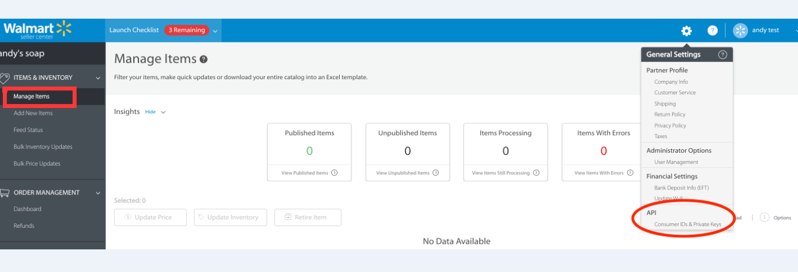
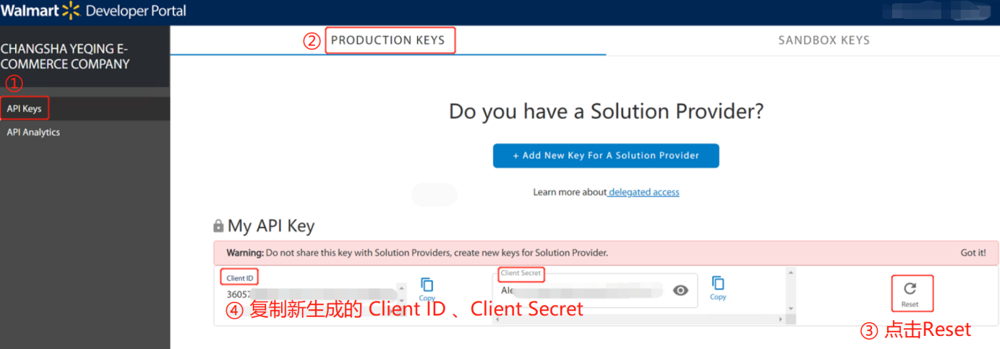
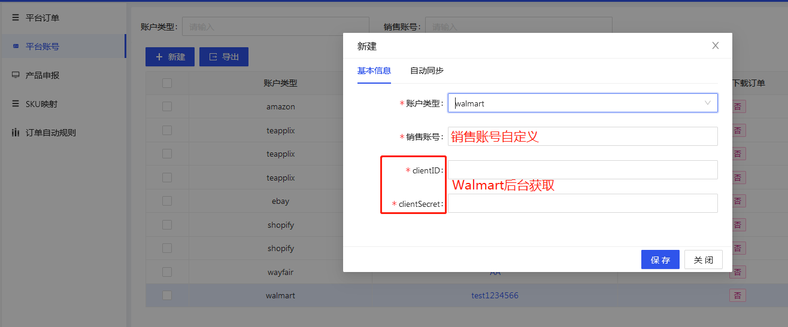

# Walmart

**注意****：1.美国站点支持授权，加拿大站点暂不支持授权**

---

** 2.只有MarketPlace这个类型的卖家才能授权**

---

登录Walmart平台，点击【Manage Items】，点击右侧【Genera Settings】，弹出下拉菜单选中【API】

将相应的client ID 和 client secret 复制到平台账号授权处保存

<!-- 源页面：https://help.dmxsmart.com/docs/wms/UserSideFunctionDescription/DocumentTutorial/SalesPlatform/SalesPlatformIntegration/Walmart -->
