# NeoBund

在客户端系统，销售 > 平台账号 > 新建

**账号类型**：neobund，

**销售账号**：自定义，

设置订单发货仓库和运送方式，由于neobund会推送跟踪单号和快递面单，请选择仓库自发货渠道

点击现在去授权，自动跳转到NeoBund后台授权（需在NB作为服务商入驻仓库后方可授权）

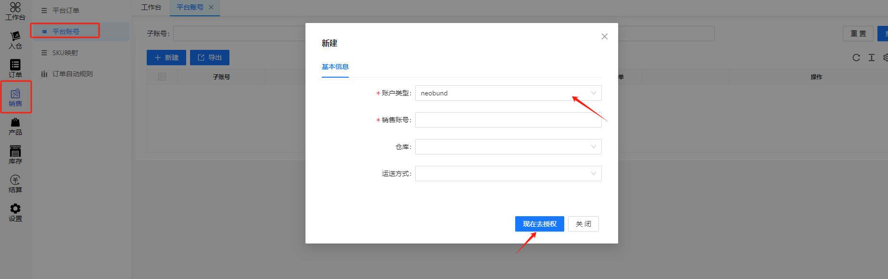

跳转后登录NB的账号

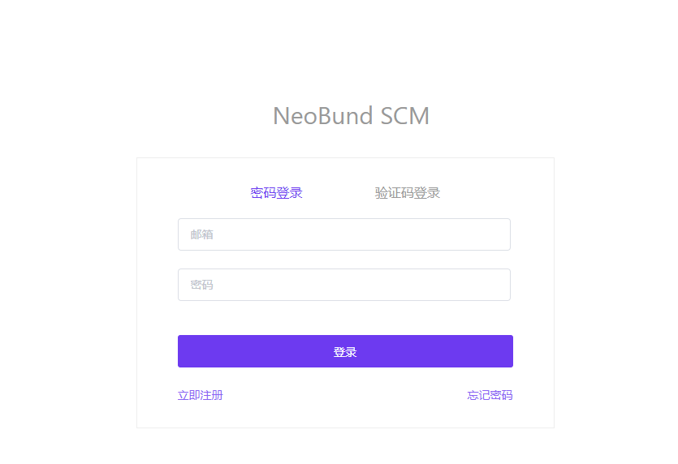

在NB后台 系统>应用市场 找到对应的程序名称， 点击授权

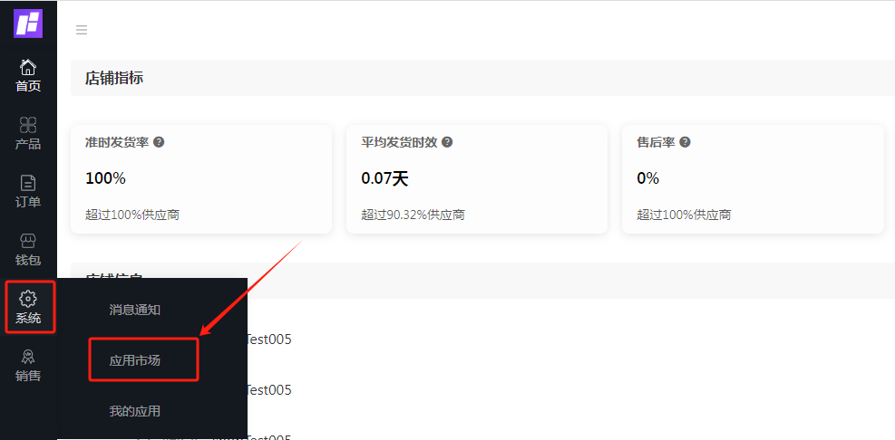

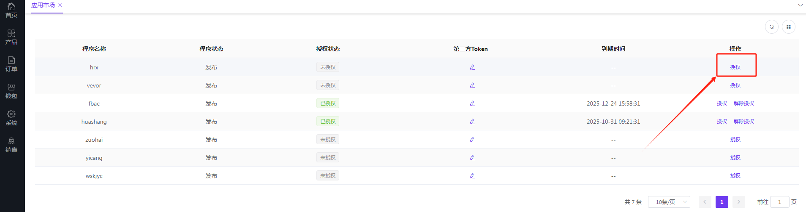

在客户端系统，设置 > webhook设置 > 新建 ，设置产品推送和产品库存同步，绑定账号

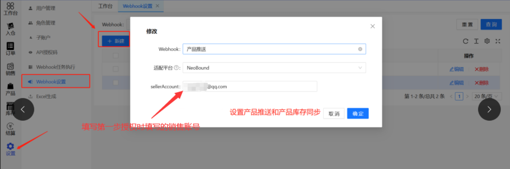

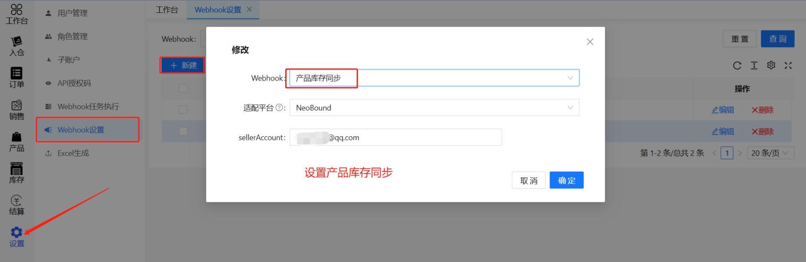

编辑账号自动同步

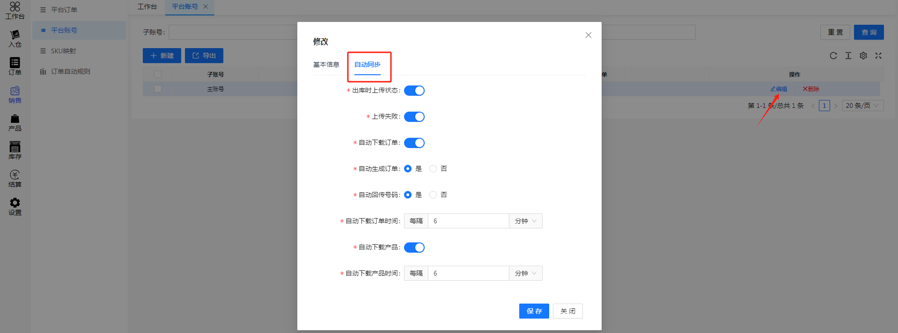

配置好账号后 通过自动同步或手动拉取同步NB订单到系统提交出库

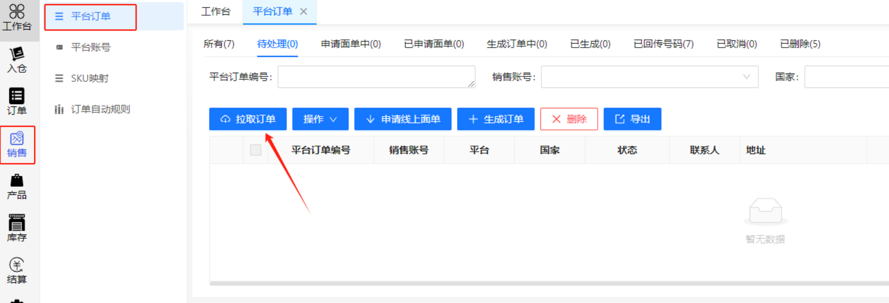

## 产品、库存同步

授权前创建的产品需手动点击推送产品至NB，授权后创建产品将自动同步产品至NB平台

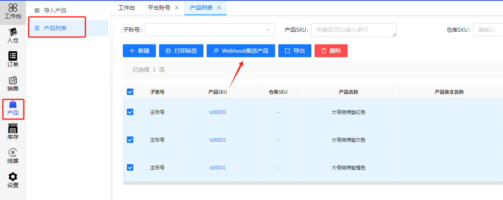

在NB平台库存管理绑定第三方sku，选择产品所在的海外仓

绑定好后，NB平台创建的产品会推送到我们系统

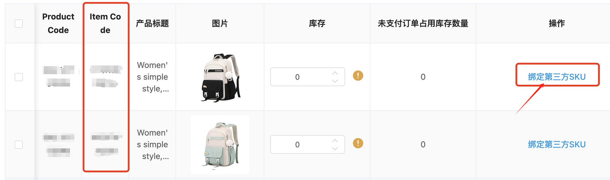

若在系统已创建该产品，可将NB平台的ltem Code填至系统 产品-代理产品编码 处，系统会进行关联，库存变动后，将推送新的库存到NB

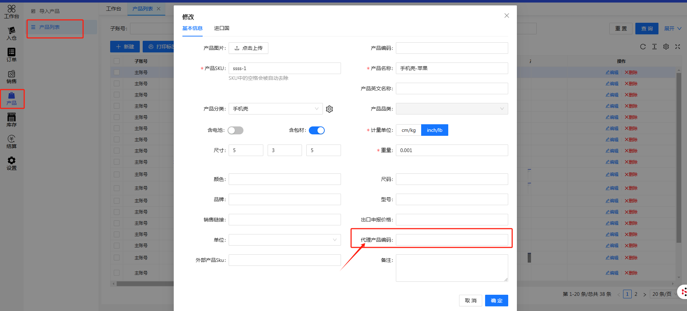

<!-- 源页面：https://help.dmxsmart.com/docs/wms/UserSideFunctionDescription/DocumentTutorial/SalesPlatform/SalesPlatformIntegration/neobund -->
