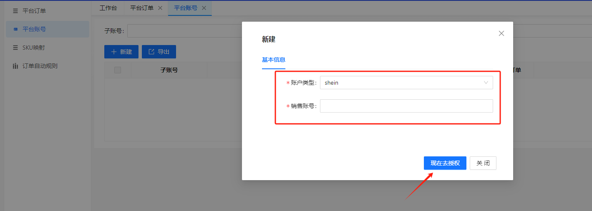
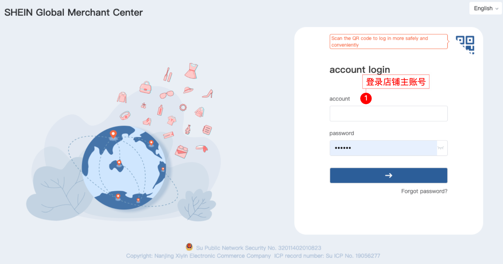
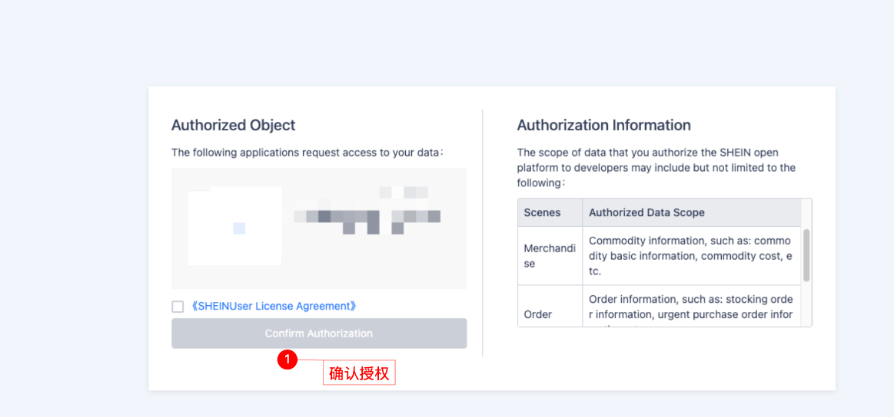
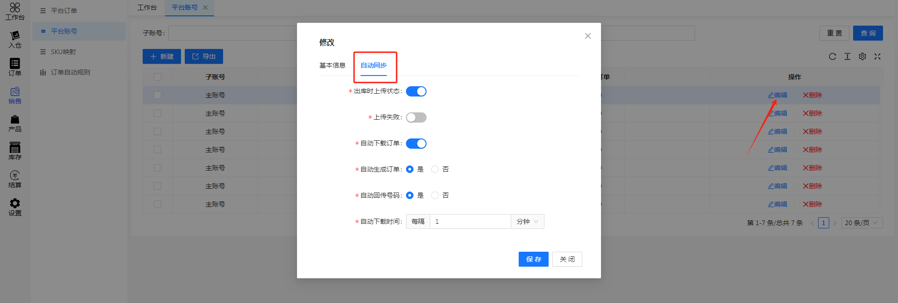
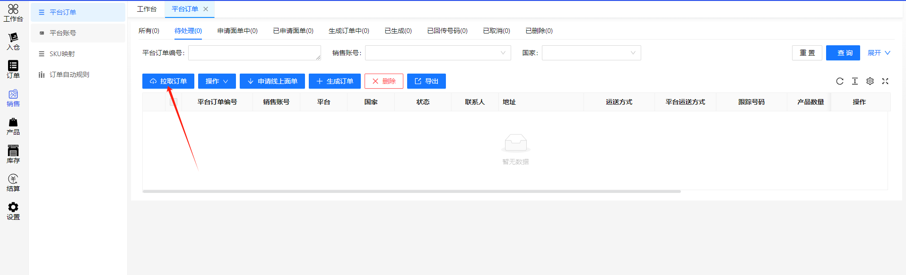
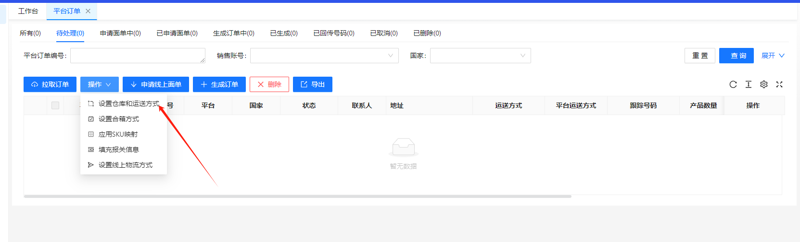
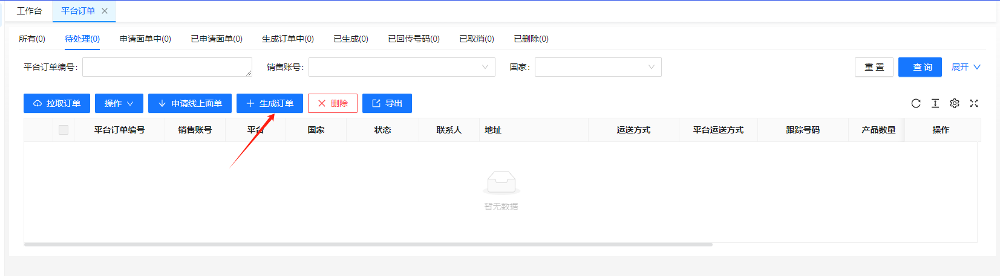

# shein

进入客户端系统授权，销售> 平台账号 > 新建

**账号类型**：shein

**销售账号**：自定义

点击**现在去授权**，跳转shein进行授权

登录shein账号并确认授权

点击编辑设置订单自动同步规则

或手动拉取订单到系统提交出库

为订单设置仓库和运送方式，生成订单

<!-- 源页面：https://help.dmxsmart.com/docs/wms/UserSideFunctionDescription/DocumentTutorial/SalesPlatform/SalesPlatformIntegration/shein -->
