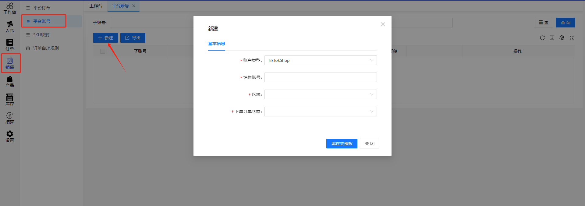
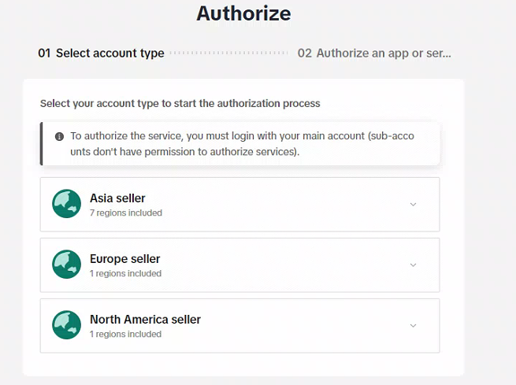
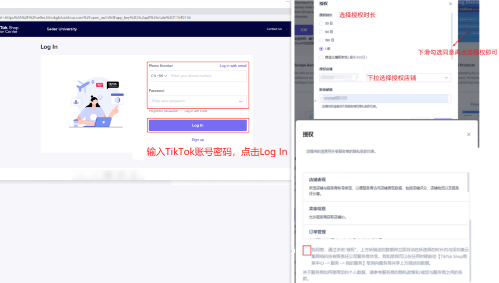
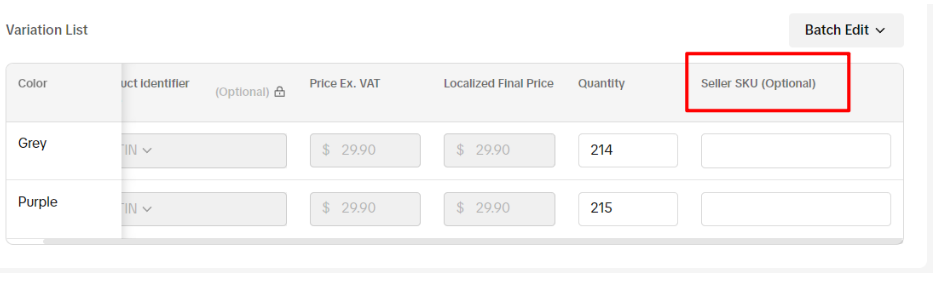
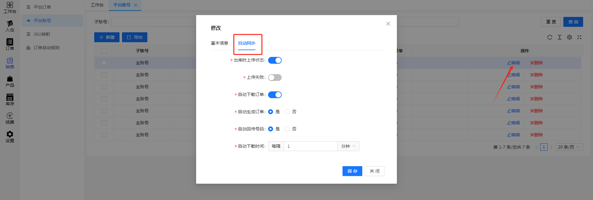
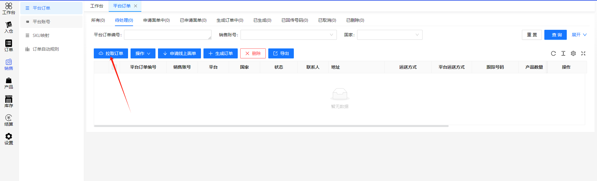
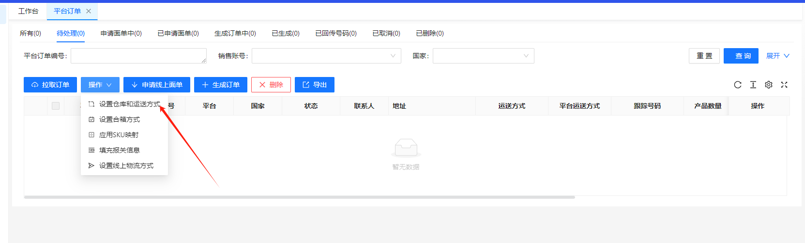
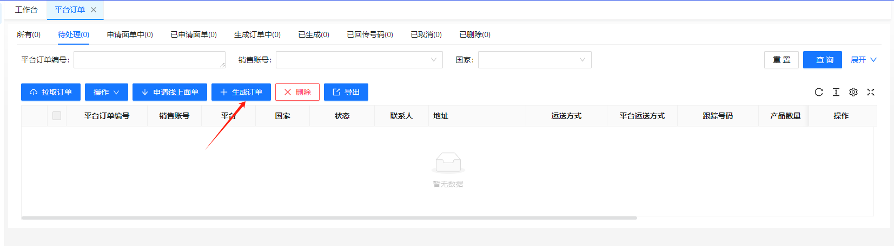

# tiktokshop

进入客户端系统授权，销售> 平台账号 > 新建

**账号类型**：TikTokShop

**销售账号**：自定义

**区域**： 美国本土店铺选择美国本土，否则就选其他

**下单订单状态**： Awaiting Shipment

点击**现在去授权**，跳转tiktokshop进行授权（ 首次授权需要登录TMS.DMXSMART.COM域名进行授权 ）

跨境店铺选择 Asia seller

登录tiktokshop账号并授权

拉单前需在tiktokshop中维护seller sku

点击编辑设置订单自动同步规则

手动拉取同步tk订单到系统提交出库

为订单设置仓库和运送方式，生成订单

<!-- 源页面：https://help.dmxsmart.com/docs/wms/UserSideFunctionDescription/DocumentTutorial/SalesPlatform/SalesPlatformIntegration/tiktokshop -->
