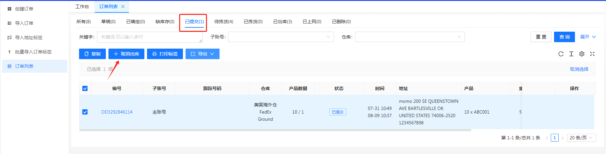
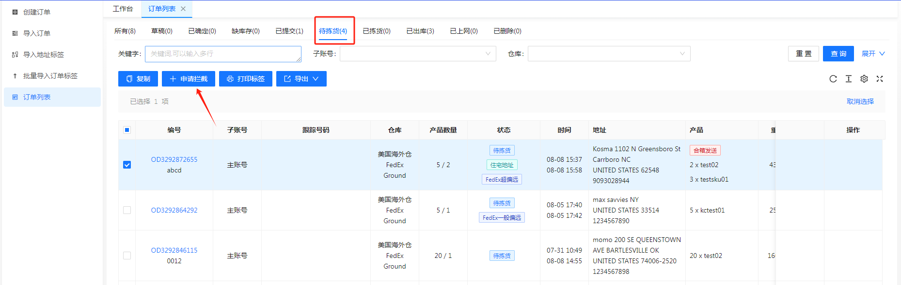
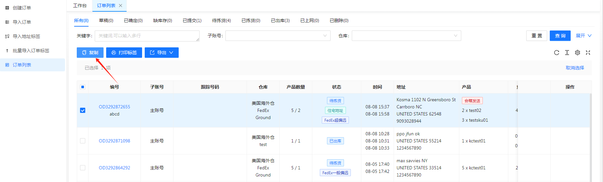

# 订单列表

【**功能概述**】订单的编辑、审核、提交以及订单在仓库的处理状态查询

**【功能入口**】（**订单**—**订单列表**）

订单提交方法参照**操作流程**里的方式提交，对于提交成功的订单如需取消订单，需在订单未进入**待拣货**状态前提交。

订单进入**待拣货**或者**已拣货**状态后，如需取消订单需要对该订单**申请拦截**，允许拦截的订单将显示**待截停**状态。

仓库在订单的出仓操作环节中会收到拦截信息并拦截货物，对于已出库的订单无法再申请拦截。

对于需要重新发货的订单，可以在订单列表里选中订单后点击**复制**，该订单信息会复制到**草稿**栏中，客户可以重新编辑后再提交出库

<!-- 源页面：https://help.dmxsmart.com/docs/wms/UserSideFunctionDescription/DocumentTutorial/orderManagement/OrderList -->
