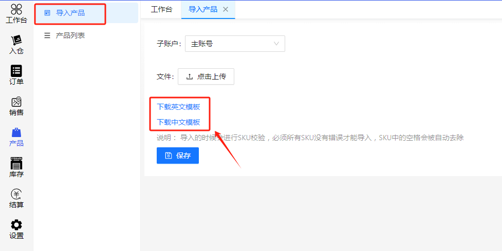
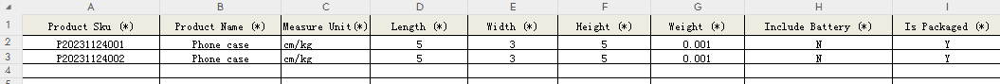
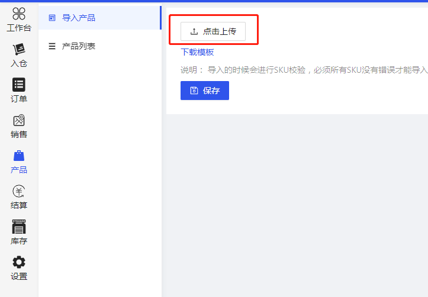
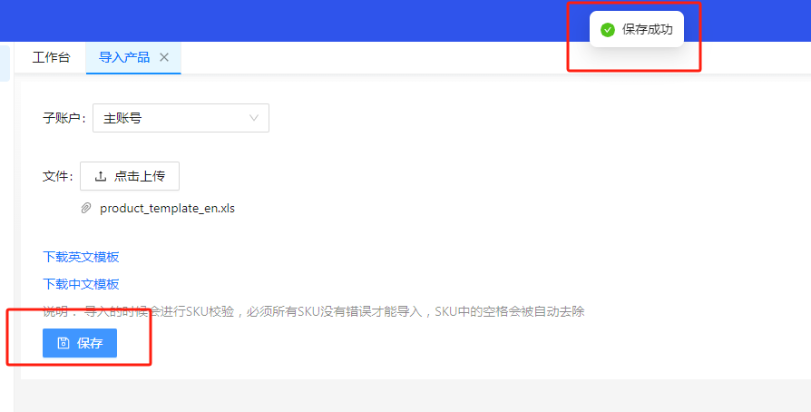

# 产品导入

【**功能概述**】产品较多时，使用模板文件批量上传产品，在下载的Excel表格中编辑好产品信息后上传文档保存。

【**功能入口**】（**产品**—**导入产品**）

下载导入模板，点击**下载模板**

---

（
当次下载当次使用，每次上传都需重新下载，不可使用之前下载模板，以免导入失败
）

填写产品信息，录入产品SKU、名称、长宽高和重量信息，产品含电池录入字母“Y”，不含电池录入字母“N”，产品外包装同理。

导入模板中 产品SKU（Product Sku ）、产品名称（Product Name）、计量单位（Measure Unit）、长（Length）、宽（Width）、高（Height）、重量（Weight）为必填项， 是否含电池(Include Battery)和是否含包材(Is Packaged)不填则默认产品含电池含包材。其他项可不填。

上传导入模板，编辑完的表格保存好后**点击上传**

文件上传成功后点击**保存**，系统提示保存成功即产品上传成功，可在产品列表查看上传的产品信息。

如果保存失败，系统会提示错误信息，请根据提示内容更改产品信息后重新上传保存。

如果导入的sku已存在，将覆盖原SKU信息

<!-- 源页面：https://help.dmxsmart.com/docs/wms/UserSideFunctionDescription/DocumentTutorial/productManagement/ProductImport -->
