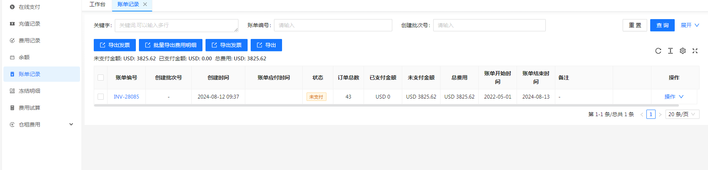
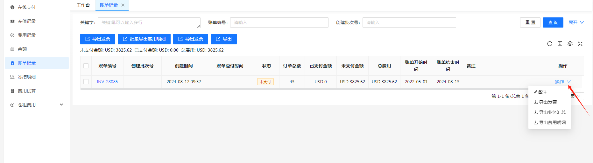

# 账单记录

【功能概述】账单费用查询，账单明细导出。

客户无法对账单费用进行任何编辑、修改等操作，账单由管理端创建，已生成的账单通过操作可以导出发票、账单明细等动作。

<!-- 源页面：https://help.dmxsmart.com/docs/wms/UserSideFunctionDescription/DocumentTutorial/settlement/BillRecord -->
