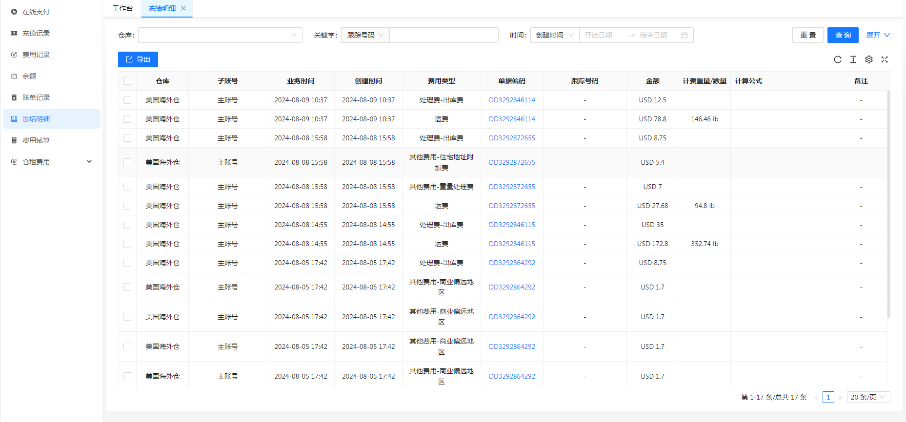

# 冻结明细

【功能概述】系统会根据提交的一件代发订单的产品信息预估一笔费用金额进行冻结，包括仓库处理费和尾程运费，在仓库操作订单出库后对冻结金额进行释放，并按实际产生费用扣除客户账户余额。

<!-- 源页面：https://help.dmxsmart.com/docs/wms/UserSideFunctionDescription/DocumentTutorial/settlement/FreezeDetails -->
