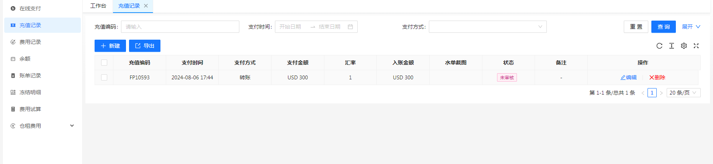
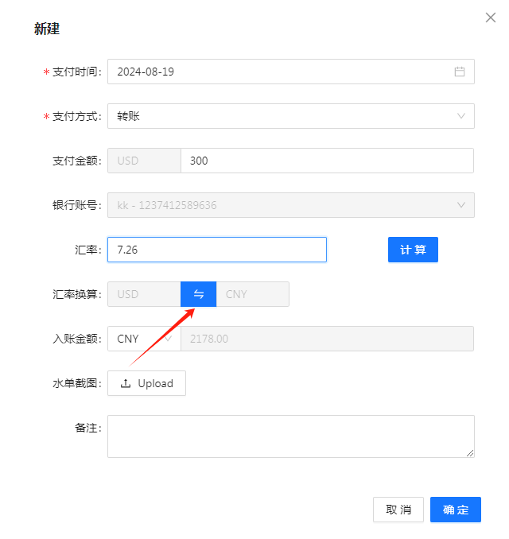
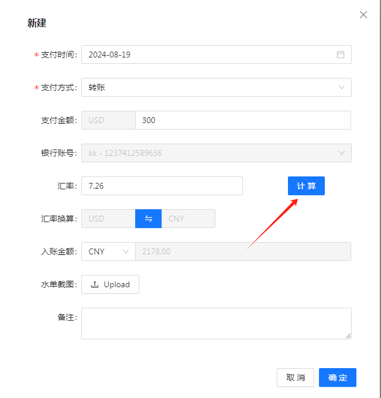
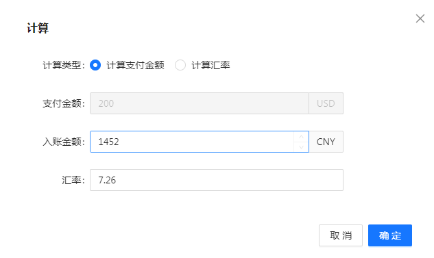
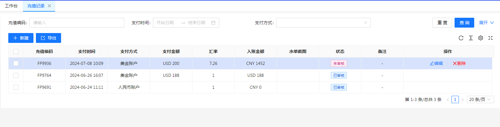

# 充值记录

【功能概述】在线充值以及线下充值记录查询。点击新建创建充值记录，客户端创建的充值记录需由管理端进行审核。

点击新建，创建充值记录，输入汇率，点击可进行汇率换算

支持币种转换汇率计算功能

保存后充值记录需由管理端审核

##

<!-- 源页面：https://help.dmxsmart.com/docs/wms/UserSideFunctionDescription/DocumentTutorial/settlement/RechargeRecord -->
