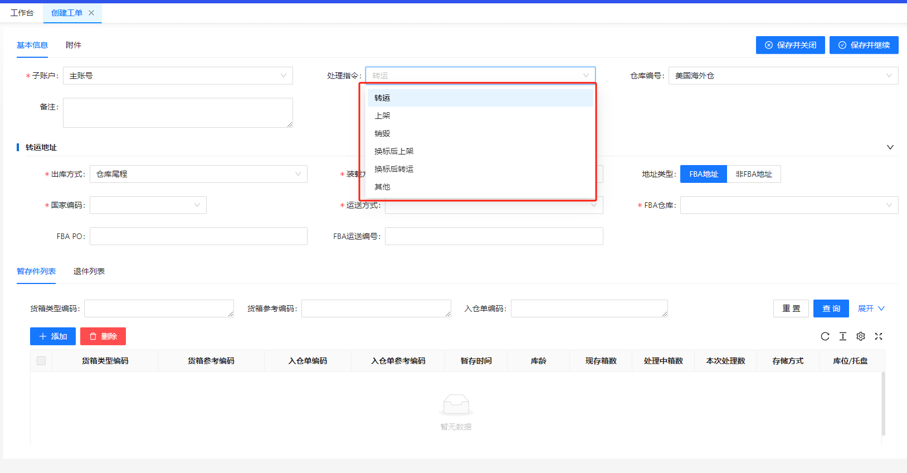
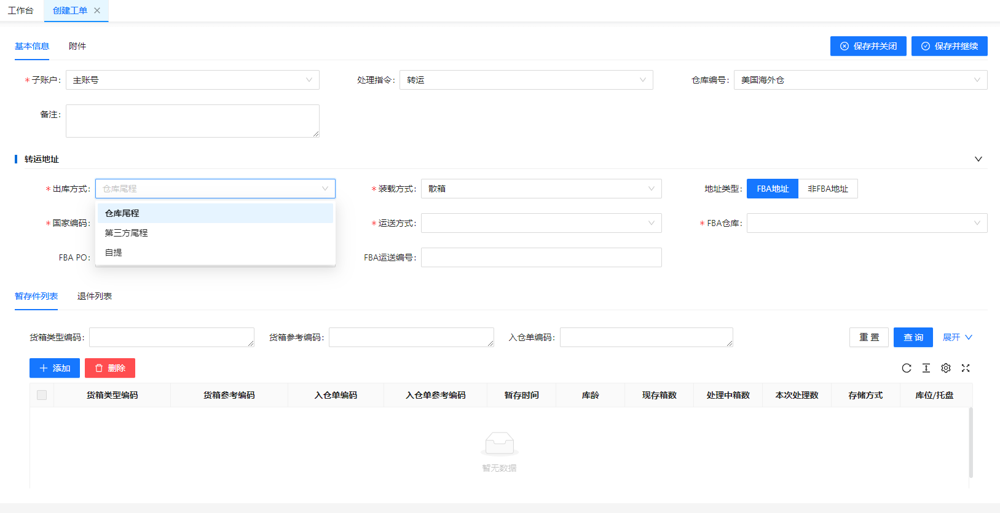
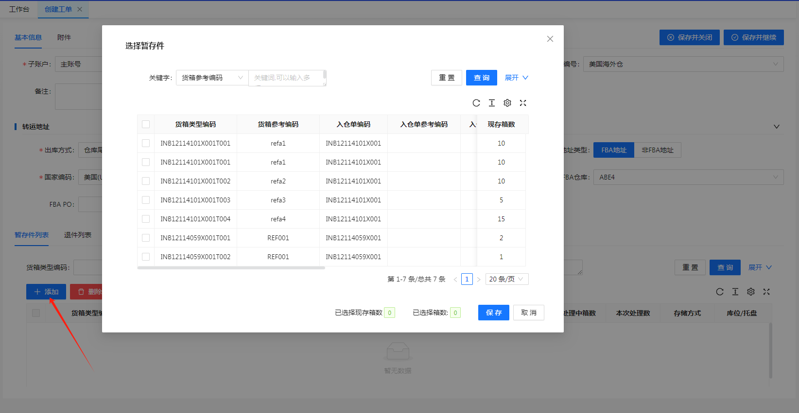
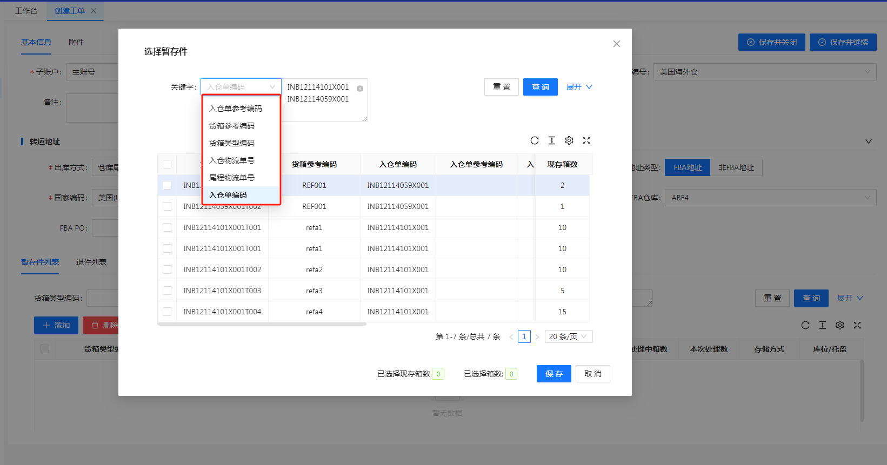
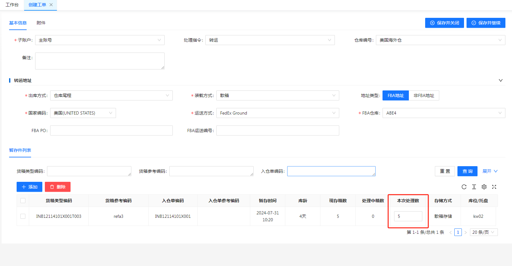
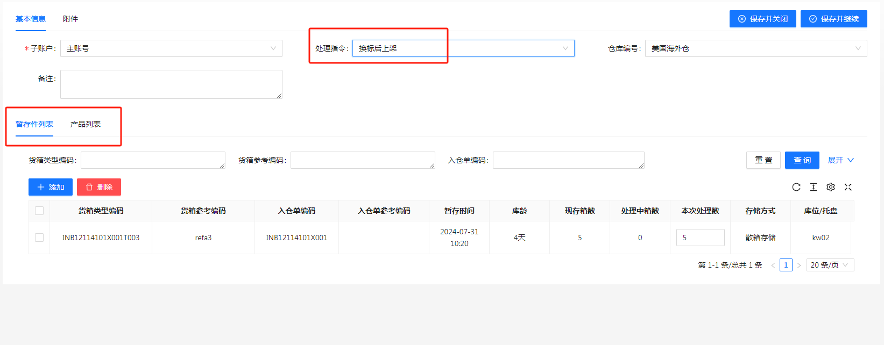
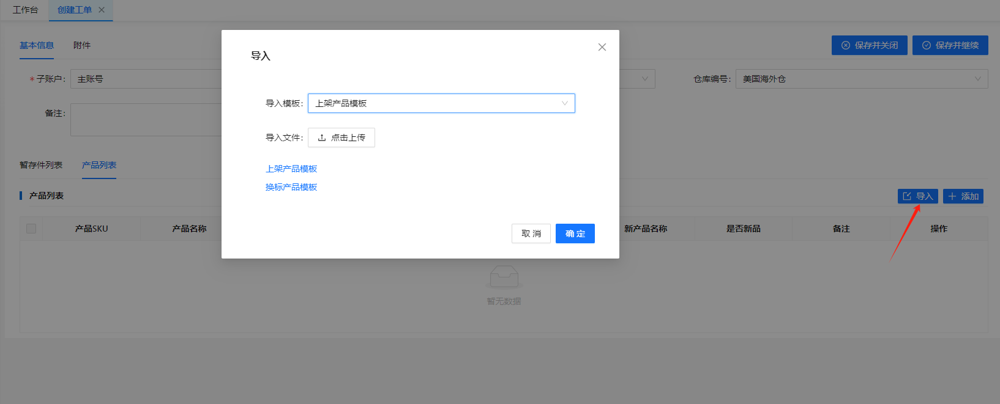
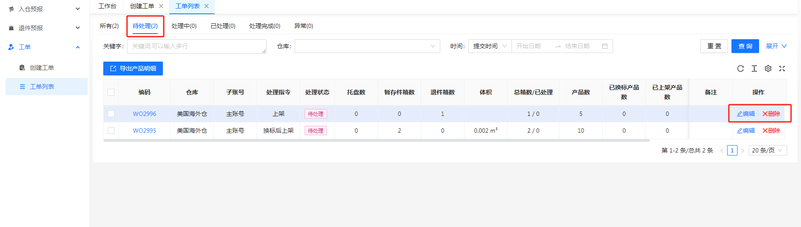

# 创建工单

【**功能概述**】在库暂存的货物需要通过创建工单的方式提交给仓库来对货物进行转运、换标、上架等操作。

**【功能入口】（入仓---工单---创建工单）**

## 

## 1.基本信息

处理动作选择要进行的操作**上架**、**转运**、**换标后转运**等，在仓库编码一栏选择想要操作的仓库(支持模糊搜索)

## 2.地址信息

处理动作选择**转运/换标后转运**需要填写转运地址信息。

选择货物的装载方式**托盘**/**散箱，**选择地址类型**FBA地址/非FBA地址**并填写相应地址等信息。

**出库方式**可选择仓库尾程/第三方尾程/自提；

**仓库尾程**是使用仓库的运送渠道进行运输；

**第三方尾程**是使用客户自己的物流商账号（如usps/fedex/ups等）进行下单尾程派送；

**自提**客户自己到仓库取货件。

## 3.暂存件选择

基本信息填写完成后，需要在**暂存件列表**点击添加勾选要处理的暂存件。

其中暂存件列表支持关键字的模糊搜索（关键字区分大小写，多个关键字搜索使用ENTER键换行分隔关键字）

选择待处理的货箱后，输入本次要处理的货箱数

**注意**：选择处理动作时除了**转运/销毁/其他**，都必须在产品列表**添加**相应的产品信息

产品列表支持批量导入产品功能，点击导入，选择并下载要导入的模板，模板填写完毕后点击上传并确定

## 4.完成工单

将所有信息填写完毕,在右上角点击保存关闭后。可以在**工单列表-待处理**找到创建的工单，通过操作可以对工单进行编辑或删除。

<!-- 源页面：https://help.dmxsmart.com/docs/wms/UserSideFunctionDescription/OperationProcess/CWorkOrder -->
