# 创建预报

【**功能概述**】客户货物发往海外仓前需做入仓预报，对发货的产品SKU、数量、外箱规格、业务类型等信息进行预报，预报数据必须与实物发送数据一致。

【**功能入口**】（**入仓—入仓预报—创建预报**）

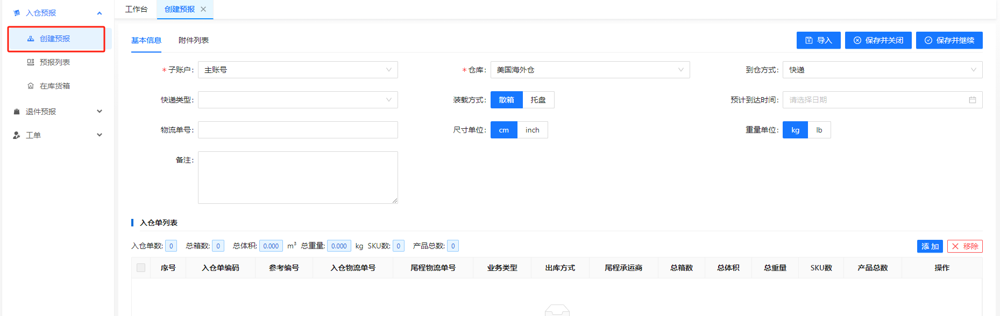

基本信息栏选择收货仓、到仓方式、快递类型等基本信息，除**快递**外的其它到仓方式需要选择货物的**装载方式**以便仓库进行计费

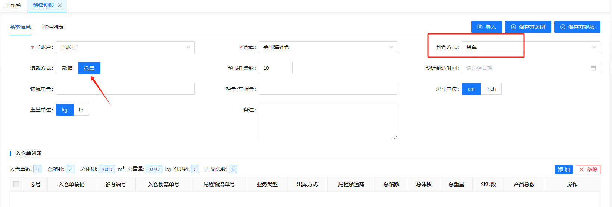

入仓列表**添加**货件信息以及选择货件的业务类型

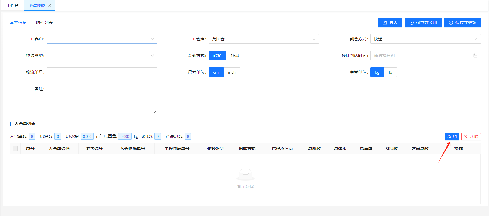

业务类型包括**暂存**、**一件代发**和**转运**，可根据自己实际业务情况进行选择

点击**添加**录入货件信息，也可以通过**导入**来批量录入货件信息

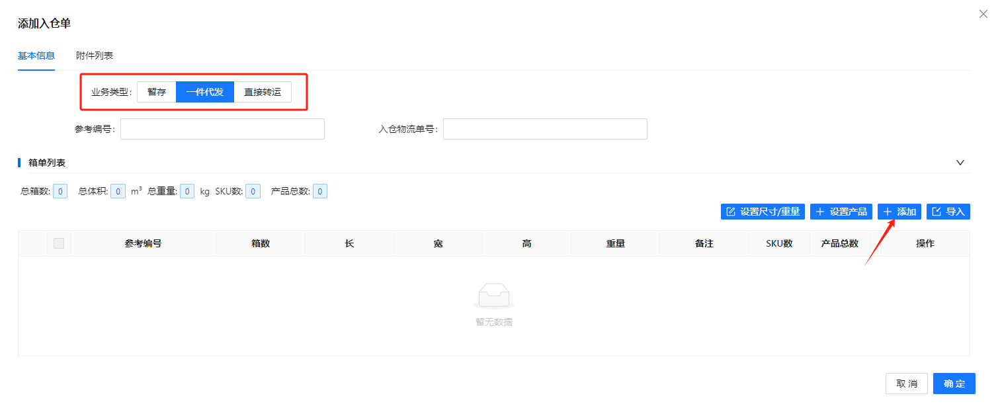

注意：一件代发业务必须录入产品信息，暂存和转运类业务可选择录或者不录

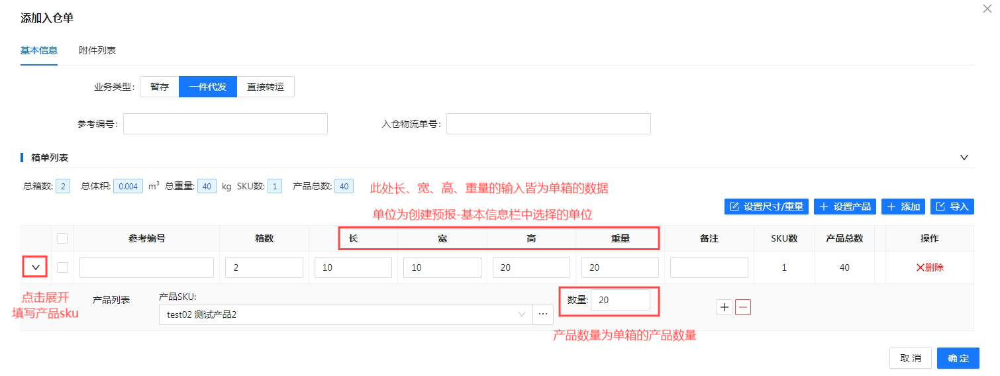

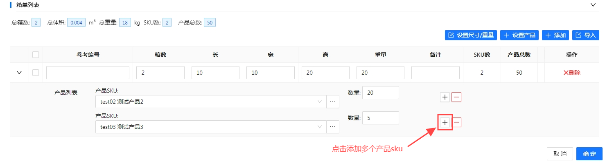

选中箱单，点击设置尺寸/重量，可一键设置箱子长宽高和重量

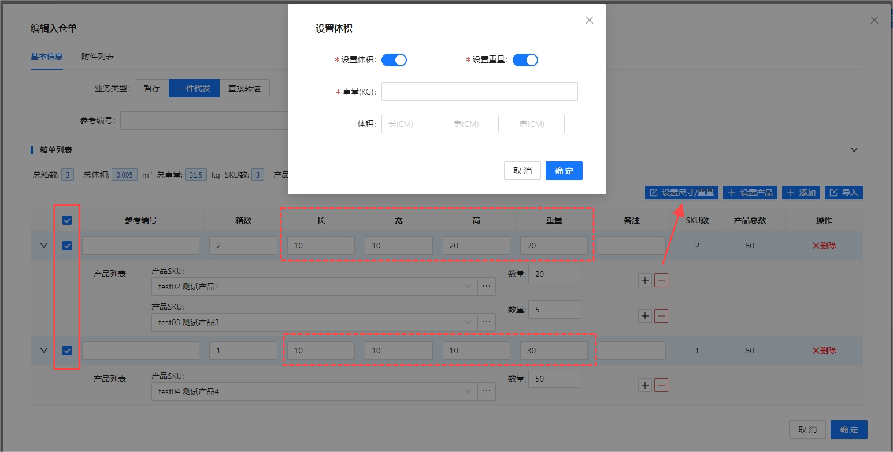

货件信息编辑完成后确定保存，入仓单创建完成

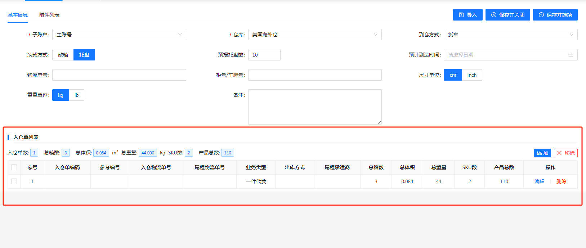

同一入仓预报可创建多个不同业务类型的入仓单，仓库收货后会根据入仓单上的业务类型对货物进行入仓处理。

点击右上角保存，入仓预报创建成功。

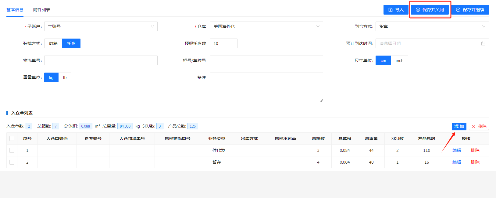

可在**预报列表—待接收**栏对预报进行查看和编辑

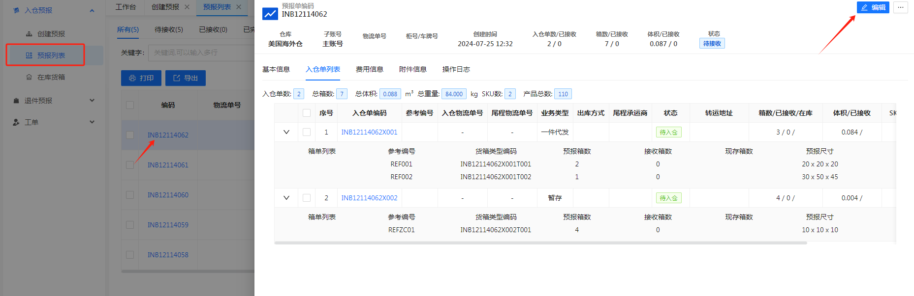

**已接收**和**已完成**栏查看货件的处理状态

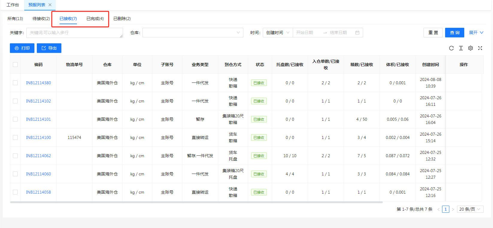

<!-- 源页面：https://help.dmxsmart.com/docs/wms/UserSideFunctionDescription/OperationProcess/CreateForecast -->
