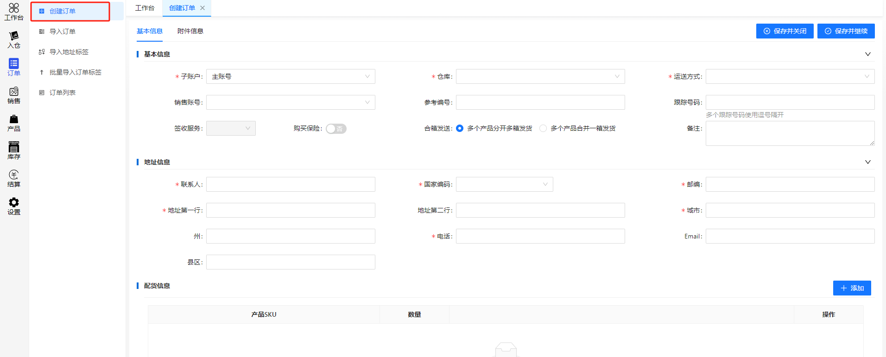
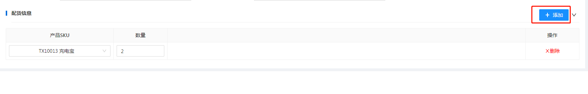
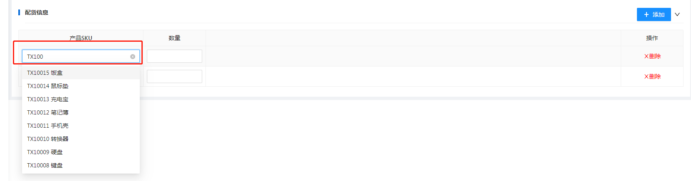
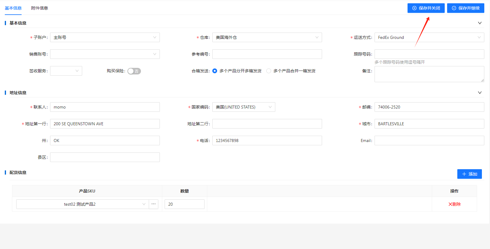
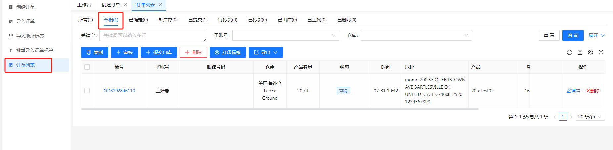

# 创建订单

【**功能概述**】仓库收货并完成上架后，产品在系统后台产生实际库存即可创建订单，做订单提交出库动作，产品没有库存或者库存数量不足的订单无法提交出库。

【**功能入口**】（**订单**—**创建订单**）

1. 地址信息编辑，选择发货仓以及运送方式，录入收件人地址信息。带红色*号为必填项。

2. 配货信息编辑，点击**添加**，选择需要发货的产品和数量。

当SKU数量多时可通过模糊搜索功能查找需要的SKU

3. 订单信息编辑完成后点击右上角**保存并关闭**，或点击**保存并继续**创建多个订单。

4. 保存后的订单可以到（**订单列表**—**草稿**）里进行编辑、审核以及提交。

<!-- 源页面：https://help.dmxsmart.com/docs/wms/UserSideFunctionDescription/OperationProcess/CreateOrder -->
