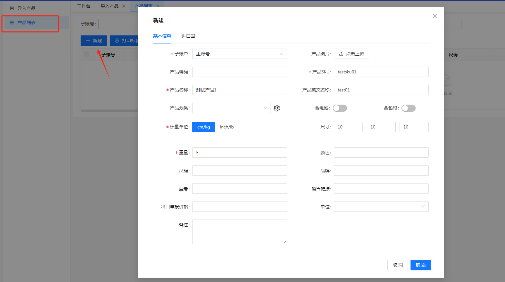
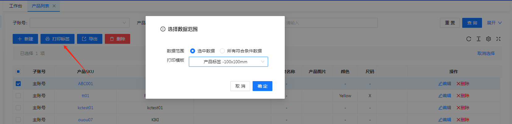
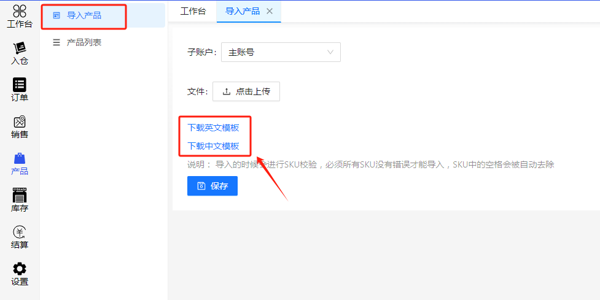
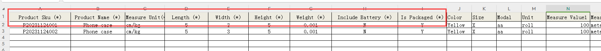

# 创建产品

【**功能概述**】客户发往海外仓的产品需预先在系统里对产品信息进行创建。

## 产品列表新建

【**功能入口**】（**产品**—**产品列表**—**新建**）

1. 在弹出的信息框中录入产品SKU、规格等信息，产品重量用于订单提交出库时预估重量。
2. 产品信息录入完成后，点击**确定**保存，编辑完成的产品信息将展示在产品列表里。

   带*号项和尺寸为必填项

3.在产品列表中选中产品，**打印标签**打印产品标签贴于产品外包装上，条码用于仓库扫描上架、拣货、出库等操作，产品SKU必须与贴于产品上的条码相同。

## 批量导入

【**功能入口**】（**产品**—**导入产品**）

下载导入模板，在模板中录入产品信息后上传保存

导入模板中 产品SKU（Product Sku ）、产品名称（Product Name）、计量单位（Measure Unit）、长（Length）、宽（Width）、高（Height）、重量（Weight）为必填项， 是否含电池(Include Battery)和是否含包材(Is Packaged)不填则默认产品含电池含包材。其他项可不填。

<!-- 源页面：https://help.dmxsmart.com/docs/wms/UserSideFunctionDescription/OperationProcess/CreateProduct -->
