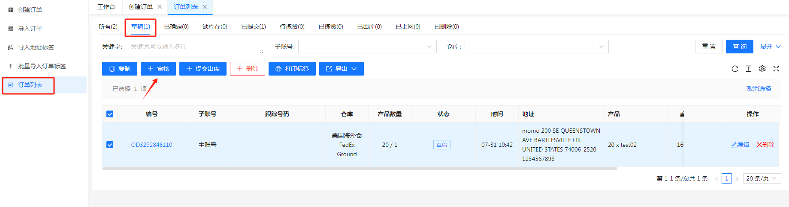
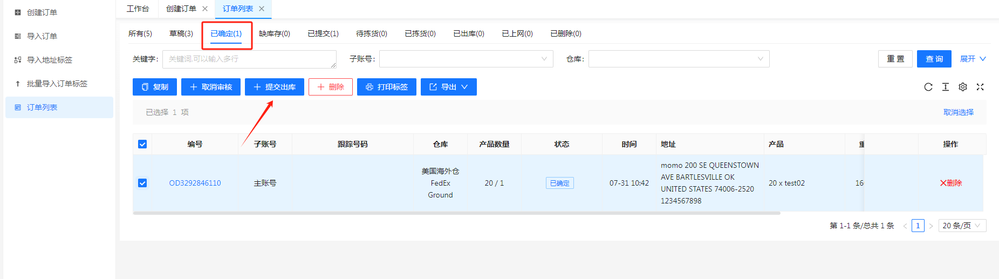
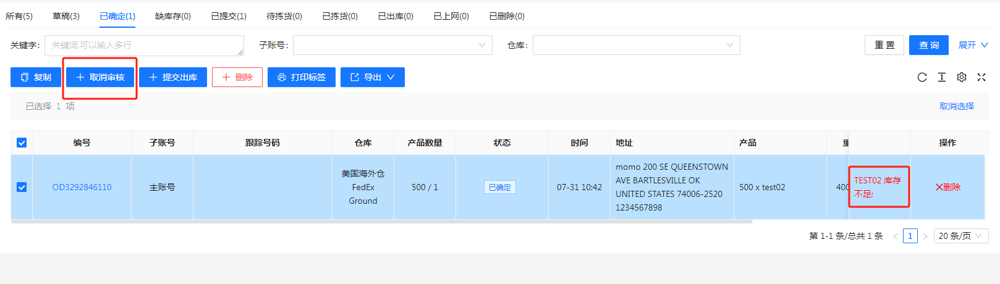

# 订单提交

## 订单列表

【**功能概述**】对创建完成的订单进行编辑、审核以及提交出库动作，只有成功提交出库的订单仓库才能对其进行操作。

【**功能入口**】（**订单**—**订单列表**—**草稿**）

1. 在草稿列表中选中订单，点击**审核**按钮对订单信息进行审核

2. 审核完成的订单会跳转到已确定列表中，选中订单点击**提交出库**按钮做订单出库

提交出库时系统会自动审核订单，如果运送方式不支持、库存不足等原因会导致订单提交失败，同时系统会提示相应的错误信息，查看错误信息后可以取消审核该订单，返回草稿列表中对订单进行修改后重新提交。

## 提交订单常见报错

**产品abc在仓库123的尺寸和重量未测量**  
SKU在该仓库未上架没有库存

**结算账户余额不足**  
客户可用余额不足，需给用户充值或增加客户信用额度

<!-- 源页面：https://help.dmxsmart.com/docs/wms/UserSideFunctionDescription/OperationProcess/OrderSubmission -->
