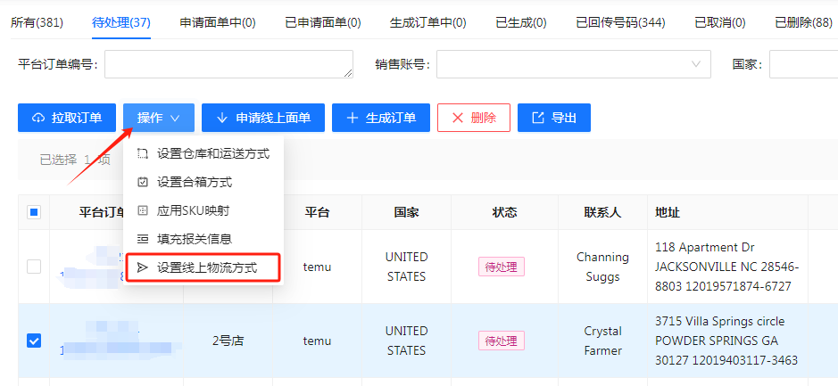
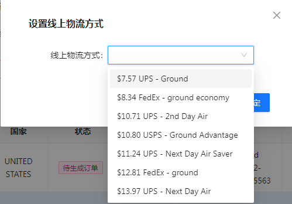
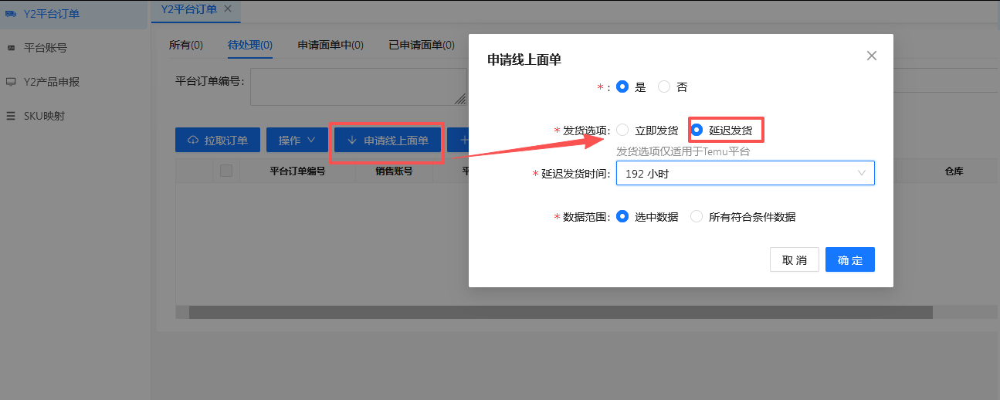
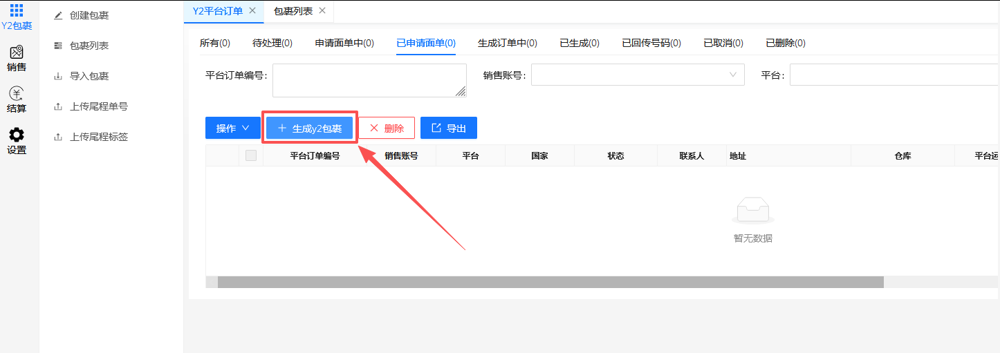
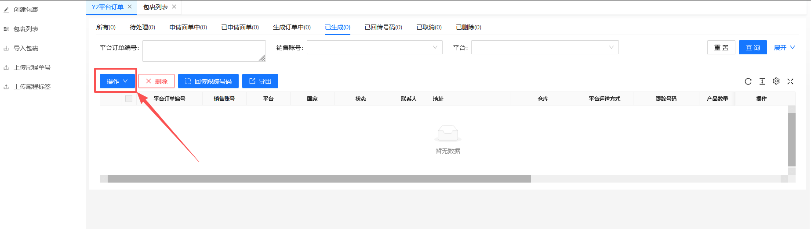

# 生成包裹

**平台订单**设置线上物流方式

选择线上物流方式，单选订单设置物流方式时可以查看到temu平台上的渠道价格，多选时不显示价格

物流方式设置成功后点击申请线上面单，系统将自动到Temu平台按选择的物流方式下单

注意Temu Y2 订单发货需选择延迟发货，发货时间选择192小时或更长的时间

下单成功后订单状态变更为已申请面单，点击**生成Y2 包裹**系统将自动生成包裹号，订单下单成功6天后，系统会自动到平台下载订单对应的尾程面单并保存到包裹号上.

打印中性标签（系统标签）贴到包裹上后自行发货到海外仓.

<!-- 源页面：https://help.dmxsmart.com/docs/y2/ClientSettings/GeneratePackage -->
