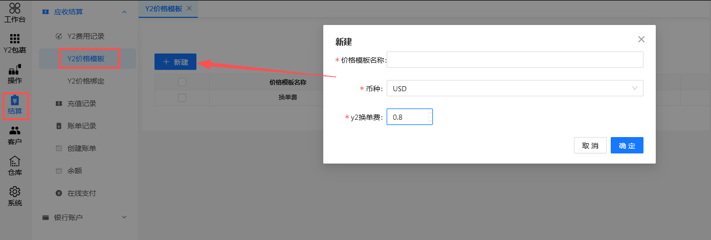
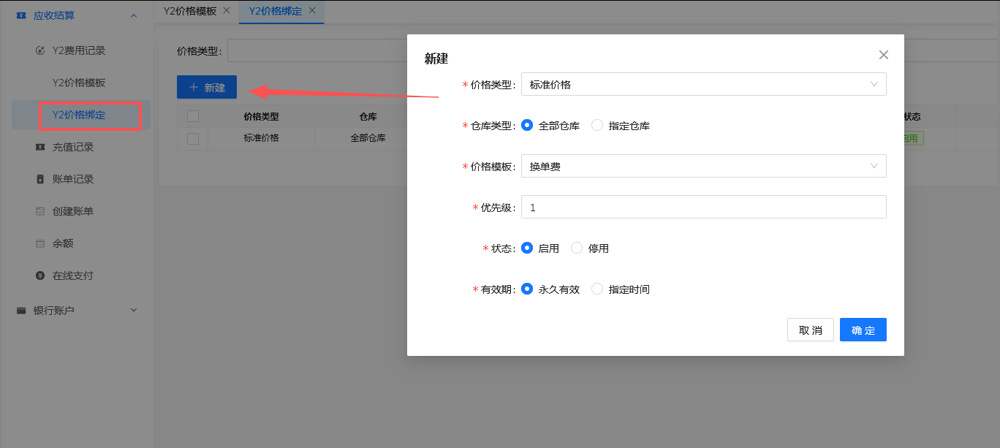
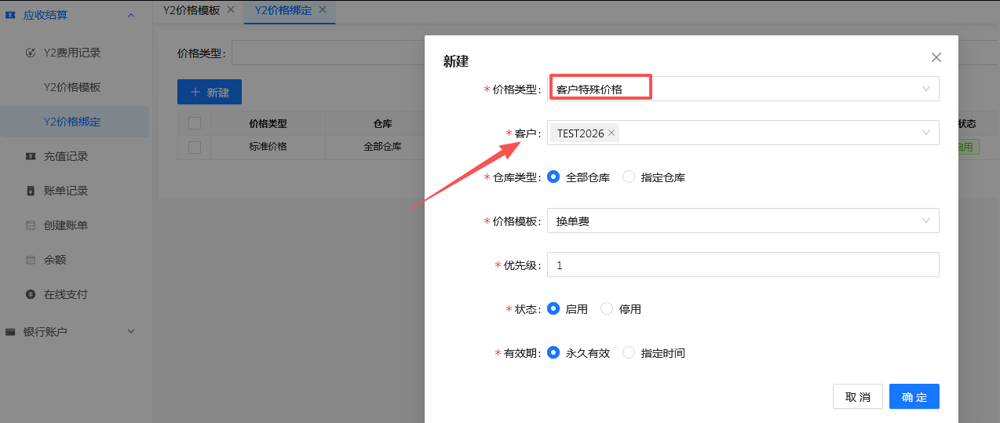

# 计费设置与绑定

【结算】---【应收结算】---【Y2价格模板】

设置模板名称、币种以及计费单价

通过价格绑定，将计费绑定给仓库或者客户计费

价格类型选择客户特殊价时可以指定客户设置特殊计费.

<!-- 源页面：https://help.dmxsmart.com/docs/y2/ManagementSettings/BillingSettingsAndBinding -->
