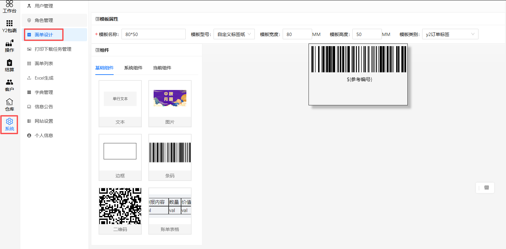
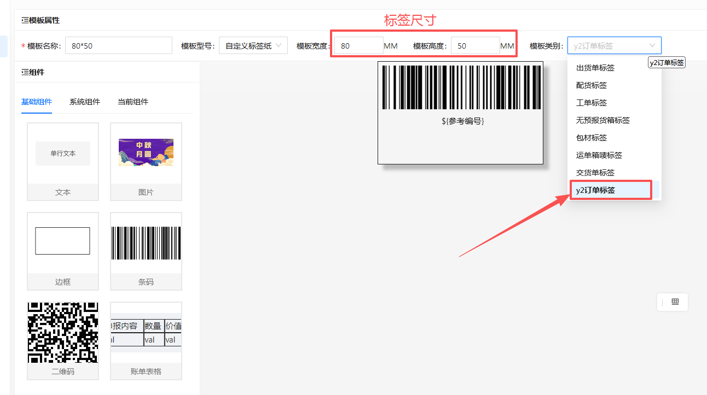
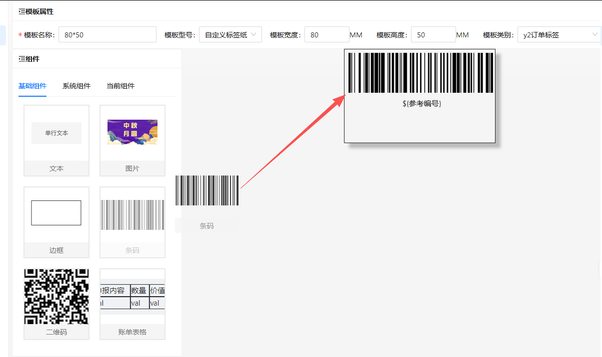
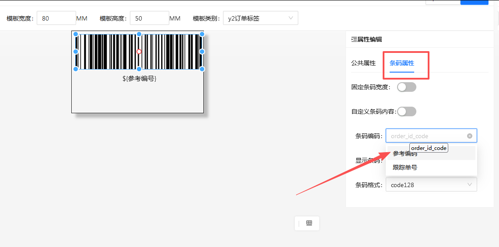
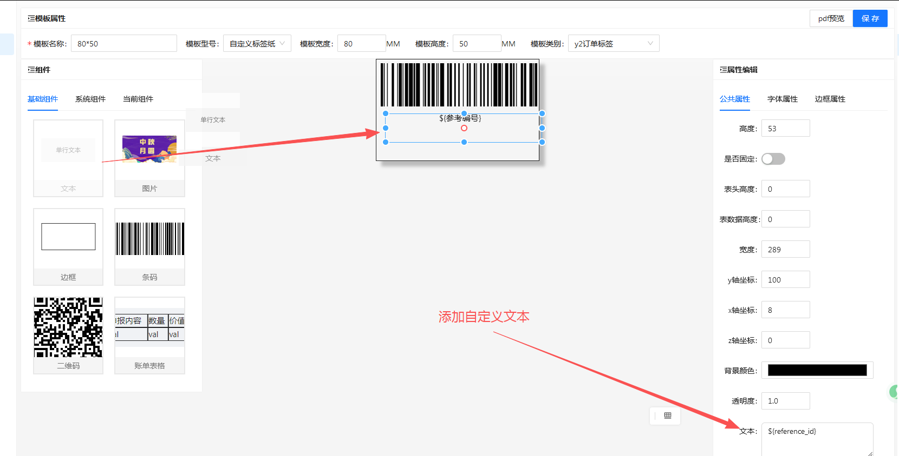
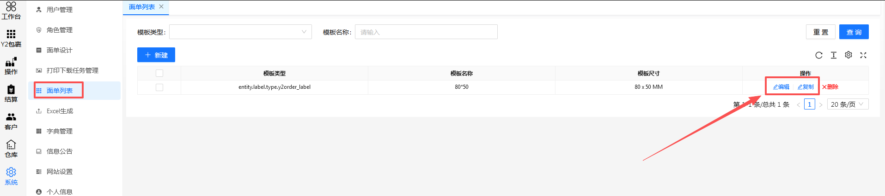

# 中性条码设置

【系统】---【面单设计】

模板类别选择**Y2订单标签**，录入模板名称以及标签尺寸大小

拖动左侧基础组件中的条码或二维码到标签上，并调整在标签上的位置以及大小

选中标签上的条码在条码属性中将条码编码调整为参考编码.

标签上如需添加其它文字内容，可在基础组件中将文本添加到标签并录入相关文字信息后保存标签

**【面单列表】**可对创建的标签进行编辑、删除以及新建等操作.

---

<!-- 源页面：https://help.dmxsmart.com/docs/y2/ManagementSettings/NeutralBarcodeSettings -->
