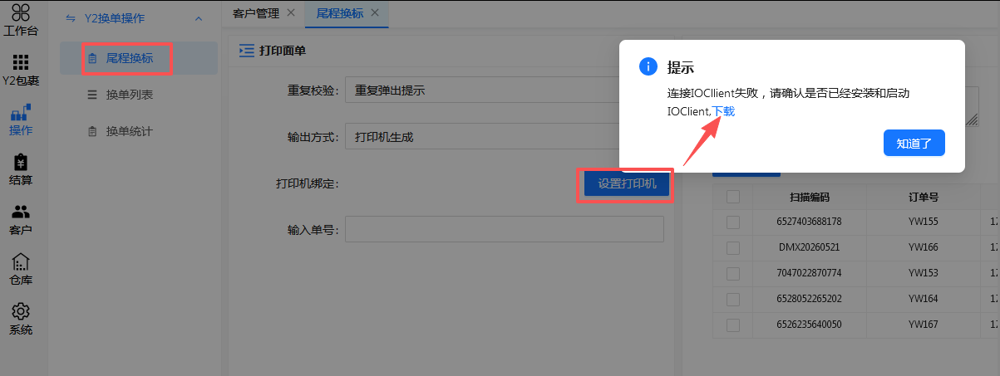
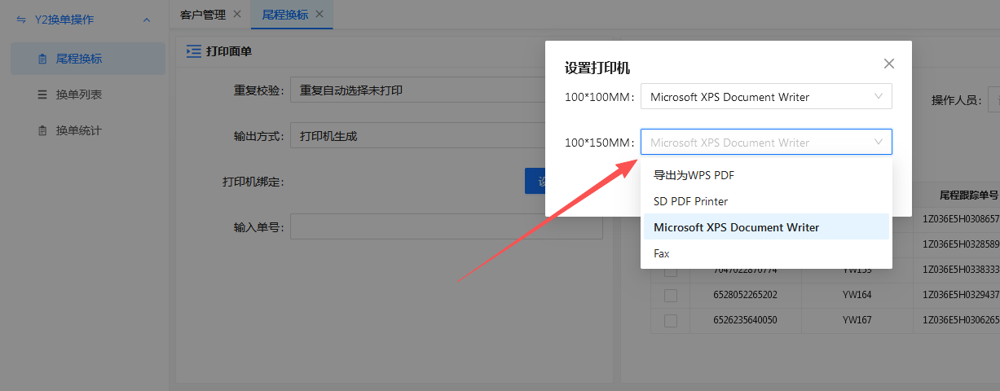
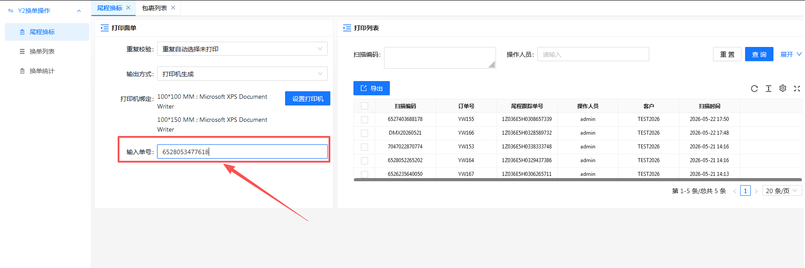
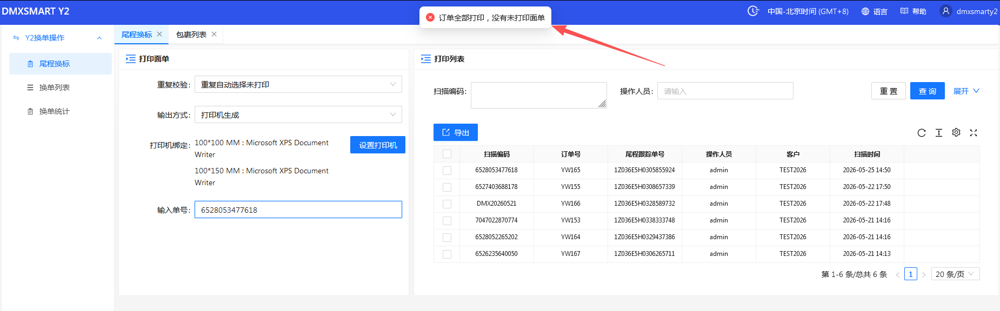
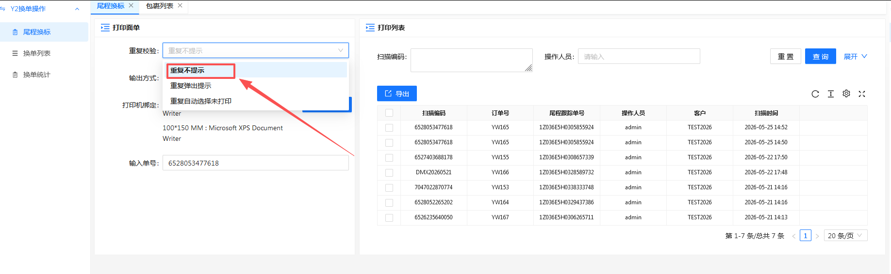
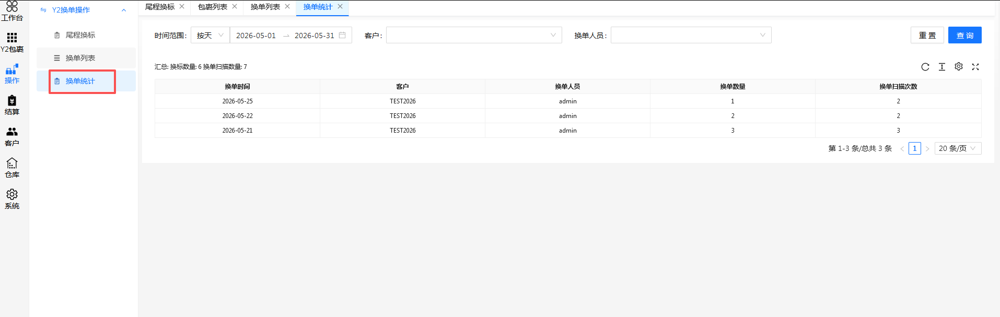

# 扫描换单

【操作】---【尾程换标】

点击设置打印机，下载插件并安装后连接打印机

选择不同标签纸尺寸推送的打印机后确定连接

在单号处扫描中性标签条码进行扫描换单，系统将自动推送尾程面单到打印机进行打印.

重复扫描时会有对应提示

如因其它原因需重新打印尾程面单时，重复校验选**重复不提示**可以重复扫描中性标签打印尾程面单

换单统计，当不同员工账号操作扫描时系统会自动统计员工账号的换单数以及扫描数.

<!-- 源页面：https://help.dmxsmart.com/docs/y2/ManagementSettings/ScanAndExchangeOrders -->
